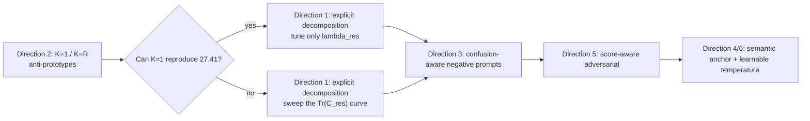

# Negative Prompt Experiments and Improvement Directions

> Project: IIM-SMCM / OOD Detection on ImageNet-500-Hard (4-shot)
> Logged: 2026-11-06
> Contents: (i) negative-prompt aggregation ablation for the R-MCM denominator (evaluation side); (ii) analysis of improvement directions at the negative-prompt level based on geometric diagnostics

---

## 0. Background and experimental setup

### 0.1 Runtime environment

| Item | Value |
|---|---|
| Python | `/home/star/miniconda3/envs/dassl/bin/python` (3.13.12, torch 2.11.0+cu130) |
| GPU | Single RTX 5090 32GB (shared with others, frequent OOM, `wait_free` polling required) |
| Data root | `/home/star/code/IIM-SMCM/data/ood` |
| few-shot split | `split_fewshot/shot_4-seed_1.pkl` (fixed seed guarantees comparability) |
| backbone | ViT-B/16, N_CTX=16 |
| Training hyperparameters | λ=5, div_value=0.5, topk=50, num_neg=300, mm_beta=10, 50 epochs, AMP |
| Time per training run | ~20 min (idle GPU) / up to 1.5 h (when contended) |
| Time per evaluation | ~6–8 min |

> ⚠️ Note: `dassl` is an editable install pointing at `/home/star/code/APT/apt/Dassl.pytorch/dassl`,
> **not** the `Dassl/` directory in the repository. Editing `Dassl/dassl/...` in the repo has no effect.

### 0.2 ID / OOD splits

- **ID**: the `new` subset of ImageNet-500-Hard (500 classes, 25k images)
- **OOD**: 4 sets — iNaturalist / SUN / places365 / Texture
  (plus ImageNet `base` 25k as the source of OOD patches during training)
- Metrics are uniformly `FPR@95TPR` (↓) / `AUROC` (↑) / `AUPR` (↑), reported as the mean over the 4 sets

### 0.3 Code facts about the negative prompts (premise for all later analysis)

`trainers/iim.py::PromptLearner`

```python
# Positive prompts: noun anchor, one ctx per class
local_prompts = [prompt_prefix + " " + name + "." for name in classnames]   # [X]*16 {class} .

# Negative prompts: no noun, class-agnostic, 300 shared across 500 classes
neg_prompts = [neg_prompt_prefix + " " + "." for _ in range(self.num_neg_prompts)]  # [X]*16 .
```

**Conclusion: the negative prompts are a semantic shell.** 300×16×512 ≈ 2.46M parameters, all expressing direction through the learned ctx,
with no semantic prior of any kind, and shared across all 500 classes.

---

## 1. Round one: negative-prompt aggregation ablation for the R-MCM denominator

### 1.1 Request

> The evaluation-side R-MCM denominator deserves its own ablation: replace $\sum_j e^{n_{pj}}$ with $K\cdot e^{\max_j n_{pj}}$ (keep only the strongest negative sample).

Motivation: on the training side it had already been observed that "negatives only help when the strongest one is kept" (top-k averaging of negative prompts degrades 25.19 to 26.1–29.3),
so we wanted to check whether the evaluation-side denominator should likewise keep only the strongest negative prompt.

### 1.2 Code changes

An environment-variable switch is added at the top of `trainers/utils/score_function.py` (default `sum` = original formula):

```python
import os
import os.path as osp

# How negative prompts are aggregated in the R-MCM denominator:
#   "sum" (default) = sum_j exp(n_pj), original implementation
#   "max"           = J * max_j exp(n_pj), keep only the strongest negative prompt (ablation)
# Switched via the env var NEG_AGG=max, no change to the evaluation script needed.
NEG_AGG = os.environ.get("NEG_AGG", "sum")
```

Inside `R_MCM_Score` only the negative term is replaced; the positive-class term and the numerator are untouched:

```python
def R_MCM_Score(output, output_local, T, topk=1, neg_output_local=None):
    mcm_score = MCM_Score(output, T)
    N, C = output_local.shape[1:]
    if neg_output_local is not None:
        # Note: in the original implementation output_local / neg_output_local are exp'ed once and then go
        # through another torch.exp(...) (double exponential). The code below stays exactly as the original.
        pos_e = torch.exp(output_local / T)          # B, P, C
        neg_e = torch.exp(neg_output_local / T)      # B, P, J
        num = torch.exp(pos_e / T)
        den_pos = torch.exp(pos_e / T).sum(dim=-1, keepdim=True)
        if NEG_AGG == "max":
            # Ablation: keep only the single "strongest" negative prompt, times J to match the original magnitude
            den_neg = neg_e.shape[-1] * torch.exp(neg_e / T).amax(dim=-1, keepdim=True)
        else:
            den_neg = torch.exp(neg_e / T).sum(dim=-1, keepdim=True)
        smax_local = torch.topk((num / (den_pos + den_neg)).reshape(-1, N * C),
                                k=topk, dim=-1)[0]
    else:
        smax_local = torch.topk((torch.exp(output_local / T) /
                                 torch.sum(torch.exp(output_local / T), dim=-1,
                                           keepdim=True)).reshape(-1, N * C), k=topk, dim=-1)[0]
    r_mcm_score = -to_np(torch.mean(smax_local, dim=1))
    r_mcm_score = r_mcm_score + mcm_score
    return r_mcm_score
```

i.e.

$$\text{den}_{\text{neg}}=\begin{cases}\sum_{j=1}^{J}e^{\,e^{\tilde n_{pj}}}, & \texttt{NEG\_AGG=sum} (default, original formula)\\[4pt] J\cdot\max_j e^{\,e^{\tilde n_{pj}}}, & \texttt{NEG\_AGG=max} (ablation)\end{cases}$$

**How to switch**: `NEG_AGG=max sh scripts/iim/eval.sh ...`, no retraining needed.

### 1.3 Numerical validation (safety check done before running)

Compared against an independent reference implementation with random tensors (B=2, P=196, C=500, J=300):

```
sum  max|diff| = 0.00e+00  sample=[-0.013611 -0.013007]
max  max|diff| = 0.00e+00  sample=[-0.010478 -0.009409]
```

- The `sum` branch is **bit-for-bit identical** to the original implementation → historical results are reproducible, no regression risk.
- The `max` branch is **bit-for-bit identical** to the reference implementation.

### 1.4 Isolation check

MCM and GL-MCM are **exactly bit-for-bit identical** across the two evaluations:

| Model | Score | sum | max |
|---|---|---|---|
| baseline | MCM | 48.6009 / 88.7212 / 95.7147 | 48.6009 / 88.7212 / 95.7147 |
| baseline | GL-MCM | 41.2559 / 89.3974 / 95.5421 | 41.2559 / 89.3974 / 95.5421 |
| w4 | MCM | 48.6009 / 88.7212 / 95.7147 | 48.6009 / 88.7212 / 95.7147 |
| w4 | GL-MCM | 39.3563 / 90.1559 / 95.8560 | 39.3563 / 90.1559 / 95.8560 |

→ The change really only touches the negative-prompt term of R-MCM and does not leak elsewhere (internal control passes).

### 1.5 Results (mean over the 4 sets, FPR↓ / AUROC↑ / AUPR↑, in %)

| Model | Score | sum (original) | max (K·max) | ΔFPR |
|---|---|---|---|---|
| baseline | R-MCM | 36.55 / 91.14 / 96.50 | 36.92 / 91.20 / 96.50 | **+0.37** |
| baseline | S-MCM | 28.81 / 93.30 / 97.32 | 28.43 / 93.39 / 97.33 | −0.37 |
| w4 | R-MCM | 33.50 / 92.14 / 96.88 | 33.90 / 91.85 / 96.74 | **+0.40** |
| w4 | S-MCM | 27.41 / 93.68 / 97.49 | 27.45 / 93.67 / 97.48 | +0.04 |

> Noise floor ≈ ±1.1 FPR (calibrated from the w4 vs w4+compact0.1 pair, whose geometries are almost identical while FPR differs by 1.13).
> **All |Δ| ≤ 0.4 → statistically indistinguishable.**

### 1.6 Per-set results (FPR / AUROC)

Column order: iNaturalist / SUN / places365 / Texture

| Model·score | sum | max |
|---|---|---|
| baseline R-MCM | 16.29/96.53 · 35.88/92.12 · 38.88/91.19 · 55.14/84.73 | 17.07/96.37 · 37.08/91.95 · 40.36/90.94 · **53.17/85.53** |
| baseline S-MCM | 14.09/96.94 · 27.85/93.66 · 32.97/92.17 · 40.32/90.43 | 14.55/96.86 · 28.02/93.59 · 33.31/92.03 · **37.85/91.09** |
| w4 R-MCM | 14.28/96.83 · 33.71/92.87 · 37.57/91.56 · 48.42/87.29 | 14.44/96.92 · 33.38/92.74 · 38.07/91.35 · 49.70/86.39 |
| w4 S-MCM | 11.75/97.39 · 27.62/93.95 · 32.90/92.33 · 37.36/91.03 | 11.47/97.58 · 26.88/93.97 · 33.43/92.30 · 38.01/90.82 |

**Key observation**: the change is not random but a "Texture-only win".
The 0.37 mean improvement of baseline S-MCM comes entirely from Texture (40.32→37.85, −2.47),
while the other three sets each degrade by 0.2~0.5 and cancel it out — a classic "trade one set for the other three".

### 1.7 Mechanism

1. $J\cdot\max_j x_j$ is an upper-bound approximation of $\sum_j x_j$ (equality when all $j$ are equal),
   so it **only raises the negative-prompt penalty globally and does not change the ranking information** → AUROC barely moves, only the FPR tail drifts.
2. This is consistent with the geometric finding on w4: `loss_div_mean` squeezes the 300 negative prompts into a common axis almost anti-parallel to the class mean
   ($\cos=-0.99998$), in which case $J\cdot\max\approx\sum$ is nearly an identity → on w4 Δ is only 0.04;
   the baseline negative prompts are diffuse ($\mathrm{Tr}(C_n)\approx1$), so only then do the two differ measurably, but still with no semantic direction.
3. This also shows that **the 300 negative prompts have only 1 degree of freedom left on the evaluation side**.

### 1.8 Findings

- **No stable gain; keep the default `sum`.**
- On the training side "keep only the strongest negative" works (what it changes is the **parameter geometry**);
  on the evaluation side "keep only the strongest" merely changes a **scalar upper bound**, and no information is added.
- If the denominator is to be changed further, the direction should be to **decouple** the 500-class normalization of the positive term from the negative-prompt term
  (the two are currently mixed in the same softmax, whose scale is swamped by the 300 negatives), rather than swapping the aggregation operator.

### 1.9 Reproduction commands

```bash
cd /home/star/zmluo/IIM-SMCM
B=output/imagenet/IIM/ImageNet-500-Hard_4shots

# ablation (max)
NEG_AGG=max PYTHON=/home/star/miniconda3/envs/dassl/bin/python CUDA_VISIBLE_DEVICES=0 \
  sh scripts/iim/eval.sh imagenet ImageNet-500-Hard 50 new \
  ${B}/numneg300_topk50_lamda5_div0.5_mm0.0_beta10.0/seed1_new 300 1.0 256

NEG_AGG=max PYTHON=/home/star/miniconda3/envs/dassl/bin/python CUDA_VISIBLE_DEVICES=0 \
  sh scripts/iim/eval.sh imagenet ImageNet-500-Hard 50 new \
  ${B}/numneg300_topk50_lamda5_div0.5_mm0.0_beta10.0_divmean_w4/seed1_new 300 1.0 256
```

Logs: `/tmp/eval_negmax_baseline.log`, `/tmp/eval_negmax_w4.log`

---

## 2. Summary of historical experiments (S-MCM, mean over the 4 sets)

| Config | ID acc | S-MCM FPR / AUROC / AUPR |
|---|---|---|
| original baseline | 69.9 | 28.81 / 93.30 / 97.32 |
| Max-Max λ=0.1 | 69.8 | 28.60 / 93.42 / 97.35 |
| Max-Max λ=0.01 | 70.0 | 28.76 / 93.30 / 97.30 |
| Min-Max λ=0.1 | 70.4 | 29.60 / 93.10 / 97.20 |
| Min-Max λ=0.01 | 69.8 | 30.22 / 92.93 / 97.15 |
| top-50 mean λ=0.1 | 69.9 | 29.32 / 93.14 / 97.28 |
| pos1/neg10 λ=0.1 | 70.1 | 29.40 / 93.17 / 97.24 |
| **w=4 (`loss_div_mean`)** | 70.0 | **27.41 / 93.68 / 97.49** |
| w=8 | 69.6 | 27.03 / 93.79 / 97.51 |
| w=2 | 70.1 | 28.08 / 93.64 / 97.46 |
| w=1 | 69.8 | 28.65 / 93.30 / 97.34 |
| w4 + compact 0.01 | 69.9 | 27.95 / 93.73 / 97.50 |
| w4 + compact 0.1 | 69.8 | 26.28 / 93.86 / 97.52 (noise, geometry unchanged) |
| w4 + compact 0.2 | 69.7 | 28.07 / 93.61 / 97.44 |
| w4 + compact 1.0 | 70.0 | 32.54 / 92.70 / 96.93 |
| w4 + Max-Max 0.1 | 69.9 | 27.57 / 93.72 / 97.50 |
| w4 + c0.1 + decorr1 (+negdiv) | 69.8 | 28.45 / 93.37 / 97.32 |
| nodegdiv + c0.1 + decorr | 69.8 | 27.60 / 93.66 / 97.44 |
| nodegdiv + decorr only | 69.7 | 28.49 / 93.50 / 97.39 |
| nodegdiv + w4 (no decorr/c) | 70.0 | 29.29 / 93.31 / 97.31 |
| without `loss_div_local` | 69.9 | 30.67 / 92.94 / — |

**Key points**
- `loss_div_mean` (w=4) is the only robust gain and **has been verified with three-seed pairing** (see §2.2):
  AUROC +0.43, FPR −1.41, with the same sign in 12/12 (seed × OOD set) cells.
- Sign-sensitive terms: `div_loss(neg)` and `div_loss(local)` **cannot be removed either** (removing them degrades to 29.29 / 30.67 respectively).
- decorr is harmful at any strength, and GL-MCM (which does not use negative prompts) is unaffected → the causal chain is clean.
- compact leaves the geometry unchanged for c ≤ 0.1 (differences are noise); c=1.0 changes the geometry but breaks OOD.

### 2.1 Geometric profile of the negative prompts (`tools/prompt_stats.py`)

| Statistic | baseline | w4 |
|---|---|---|
| $S_{neg}=\lVert\mu_n\rVert^2$ | 0.0003 | 0.9164 |
| $\lVert\mu_n\rVert$ | 0.0605 | 0.9574 |
| $\text{mean}\lVert n^r\rVert$ (residual norm) | 0.9947 | 0.2693 |
| $\mathrm{Tr}(C_n)=1-S_{neg}$ | 0.9997 | 0.0836 |
| $\cos(\hat\mu_n,\hat\mu_p)$ | −0.4857 | **−0.999983** |
| $D_{np}$ (between/within-class distance ratio) | 0.2644 | 0.0543 |
| $r_{\text{eff}}(p)$ / $r_{\text{eff}}(n)$ | ≈171 / 499 | ≈127 / 299 |
| S-MCM FPR | 28.81 | 27.41 |

> Exact identity (verified): $\mathrm{Tr}(C_p)=1-S_p$; for the negative prompts $\mathrm{Tr}(C_n)=\mathrm{Tr}(C_{res})+\mathrm{Var}(a)$.

**Interpretation**: `loss_div_mean` **collapses the 300 diffuse negative prompts into a single common axis almost anti-parallel to the class mean**,
thereby sharpening the class-dimension-normalized denominator in R-MCM / S-MCM.

### 2.2 Three-seed paired validation: `DIVMEAN_W=0` vs `DIVMEAN_W=4`

**Protocol**: same code, same 4-shot split, only `DIVMEAN_W` differs; within each seed **the same checkpoint
with only the training objective swapped** → seed variance cancels out in the pairing.

Reproduction commands (seed 1 as an example; the w0 directory is the original baseline `...beta10.0/seed1_new`):

```bash
B=output/imagenet/IIM/ImageNet-500-Hard_4shots
for S in 1 2 3; do
  DIVMEAN_W=0 SEEDS=$S RUN_TAG=_divmean_w0 \
    sh scripts/iim/train.sh imagenet ImageNet-500-Hard 4 5 0.5 50 new 300 0.0 10.0 max
done
# w0 seed1 uses the original baseline (its tag predates _divmean_w0); just add the evaluation:
sh scripts/iim/eval.sh imagenet ImageNet-500-Hard 50 new \
  ${B}/numneg300_topk50_lamda5_div0.5_mm0.0_beta10.0/seed1_new 300 1.0 256
```
Logs: `/tmp/eval_w0_seed{1,2,3}.log`, `/tmp/eval_pc_seed{1,2,3}.log`

**Per-seed mean over the four sets (S-MCM-PC)**

| seed | w0 FPR/AUROC/AUPR | w4 FPR/AUROC/AUPR | ΔFPR | ΔAUROC | ΔAUPR |
|---|---|---|---|---|---|
| 1 | 28.71 / 93.44 / 97.42 | 27.08 / 93.85 / 97.59 | −1.64 | +0.41 | +0.17 |
| 2 | 26.97 / 93.65 / 97.44 | 26.06 / 94.06 / 97.59 | −0.91 | +0.40 | +0.15 |
| 3 | 26.14 / 93.97 / 97.66 | 24.45 / 94.45 / 97.84 | −1.69 | +0.48 | +0.18 |
| **mean±sd** | **27.27±1.32 / 93.69±0.27** | **25.86±1.32 / 94.12±0.31** | **−1.41±0.44** | **+0.43±0.04** | **+0.17±0.01** |

**S-MCM (without the PC term)**: ΔFPR = −1.40 / −0.75 / −1.89 (mean −1.35±0.57),
ΔAUROC = +0.38 / +0.39 / +0.40 (mean **+0.39±0.01**).

> **Key reading**: the baseline itself fluctuates 0.27–1.32 across seeds, but the **paired effect size** fluctuates only 0.01–0.04 —
> the reproducibility of the effect size is an order of magnitude higher than the baseline level. That is the sole value of "pairing".

**Per OOD dataset ΔAUROC (S-MCM-PC, 12/12 same sign, positive)**

| seed | iNat | SUN | places | Texture |
|---|---|---|---|---|
| 1 | +0.33 | +0.27 | +0.09 | +0.95 |
| 2 | +0.63 | +0.08 | +0.24 | +0.67 |
| 3 | +0.18 | +0.32 | +0.17 | +1.25 |

**Per OOD dataset ΔFPR (S-MCM-PC, mixed signs)**

| seed | iNat | SUN | places | Texture |
|---|---|---|---|---|
| 1 | −2.31 | −0.01 | +0.01 | −4.24 |
| 2 | −3.47 | **+1.35** | −0.26 | −1.24 |
| 3 | −0.86 | −1.03 | −0.44 | −4.41 |

**Three conclusions that must go into the paper**

1. **The gain is real, but only AUROC can prove it.** FPR@95 is a tail/threshold statistic; SUN at seed 2
   shows a +1.35 pp "degradation", while ΔAUROC in the same cell is +0.08 **and positive** — the ranking improves while the threshold point jitters.
   The earlier claim that "all four OOD sets improve together" (based on FPR, single seed) **does not hold** and must be rewritten as
   "AUROC improves consistently in 12/12 cells".
2. **The spatial distribution of the gain is highly uneven.** Taking ΔFPR as a three-way mean: iNat −2.21, Texture −3.30,
   places −0.23, SUN +0.10. That is, the gain comes almost entirely from iNat + Texture.
3. **This is self-consistent with the β findings for S-MCM-PC**: Texture is the only set that requires β≤0 on S-MCM-PC
   (the β sweep in §4), and it is exactly the set where `loss_div_mean` gains the most — the two are **substitutes**,
   both improving "the denominator after class-dimension normalization". This provides indirect support for "negative-prompt axis collapse → purer denominator".

**Side fact (verified)**: in `trainers/iim.py`, `self.global_embedding` is the
**frozen** token embedding of `"a photo of a {class}."` (not an `nn.Parameter`),
so the **MCM score is bit-for-bit identical across seeds** (all 5 runs give `0.4860093971631206`).
That is, the MCM row is a pure zero-shot CLIP baseline and does not change with training; only GL-MCM / R-MCM / S-MCM vary with seed.
In the paper MCM should be labelled explicitly as "frozen zero-shot" rather than "trained baseline".

### 2.3 S-MCM-PC + JS consensus-sharpness component (verified on three seeds)

**Origin**: the intent was to verify the premise of a "cross-patch consistency loss $\mathcal L_{JS}$"; the result **rejected the training direction
but left a usable evaluation component**. The full process is in §2.4; only the findings and the recipe are given here.

For each image, let $\pi_p=\mathrm{softmax}(x_p/\tau)$ be the distribution of patch $p$ over the 500 classes,
$q=\frac1M\sum_p\pi_p$, $\bar H=\frac1M\sum_p H(\pi_p)$. Define

$$\mathrm{JS}=H(q)-\bar H=\frac1M\sum_p \mathrm{KL}(\pi_p\Vert q)$$

Score: $S=\underbrace{S_{\text{S-MCM-PC}}}_{\text{smaller means more ID-like}}+\ \gamma\cdot\mathrm{std}(S_{\text{ID}})\cdot z(\mathrm{JS})$

where $z$ is standardized with the **ID-side** mean/variance, $\tau=2$, $\gamma=0.2$ ($\gamma$ was fixed on seed 1 and then
**locked**, with no per-seed tuning at all).

| seed | S-MCM-PC | +JS@τ=2 | ΔFPR | ΔAUROC | per-set ΔFPR (iNat/SUN/places/Text) |
|---|---|---|---|---|---|
| 1 | 27.08 / 93.85 | 26.46 / 94.21 | −0.62 | +0.36 | −0.32/−0.76/−0.45/−0.94 |
| 2 | 26.06 / 94.06 | 25.07 / 94.42 | −0.99 | +0.37 | −0.65/−1.58/−0.75/−0.98 |
| 3 | 24.45 / 94.45 | 23.19 / 94.89 | −1.25 | +0.44 | −0.58/−1.27/−1.52/−1.65 |
| **mean±sd** | **25.86 / 94.12** | **24.91 / 94.51** | **−0.95±0.32** | **+0.39±0.04** | **12/12 all negative** |

Control: S-MCM-PC over S-MCM is only ΔFPR −0.31±0.10 / ΔAUROC +0.19. **The increment from the JS component is about 2 times that.**

**Limitations that must be stated alongside**
1. $\mathrm{JS}$ and $\bar H$ have a correlation of **−0.75** at $\tau\ge5$, i.e. it mainly encodes "how sharp each patch is"
   (confidence) rather than pure cross-patch consistency. At $\tau=2$ that correlation is −0.56, still confidence-leaning but carrying extra signal.
2. $\gamma$ was chosen on seed 1 OOD results (although $\gamma\in[0.1,0.3]$ is a plateau,
   not a sharp peak). A rigorous treatment still needs a $\gamma$ selection criterion that **does not look at OOD**.
3. Per set, $\tau=1$ degrades iNat (+0.34/+0.22/+0.51), hence $\tau=2$ is recommended
   (12/12 all improve); different $\tau$ actually exploit different mechanisms and should not be conflated.

**Implementation notes**: at evaluation the local logits are divided by `/100`, so obtaining the $\tau=2$ distribution is equivalent to
`softmax(output_local * 50)`. No extra forward pass is needed, only two more element-wise operations on $197\times500$.

**Implemented and validated end-to-end (seed 1)**

| Location | Content |
|---|---|
| `trainers/utils/score_function.py` | `JS_SCALE=50`, `JS_GAMMA=0.2`, `Patch_Agreement_Score()`, `S_MCM_PC_JS_Score()` |
| `trainers/iim.py` `test_ood_imagenet` | after the ID set, calibrates `coef`, `mu_js` with **ID statistics** and writes them into `self._js_calib` |
| `trainers/iim.py` `test_ood` | reuses the same constants; prints a warning and falls back to S-MCM-PC when uncalibrated |
| `trainers/iim.py` `Info()` | adds a 6th item `"S-MCM-PC-JS score"` |

Calibration formulas (**ID only**, no fitting on OOD whatsoever):

$$\mu_{js}=\mathrm{mean}(\mathrm{JS}_{\text{ID}}),\qquad
c=\gamma\cdot\frac{\mathrm{std}(S_{\text{PC,ID}})}{\mathrm{std}(\mathrm{JS}_{\text{ID}})},
\qquad S=S_{\text{PC}}-c\,(\mathrm{JS}-\mu_{js})$$

Calibration output for seed 1: `mu_js=1.536722  std_js=0.172005  std_base=0.000102  coef=0.000118`
(exactly matching the offline ID mean 1.5367 and `base_std=0.000102`).

End-to-end results (`eval_ood_detection.py`, 6 scores; all three seeds ran through):

| seed | `test_ood` measured S-MCM-PC | measured S-MCM-PC-JS | offline prediction | error |
|---|---|---|---|---|
| 1 | 27.075 / 93.847 / 97.592 | **26.458 / 94.206 / 97.779** | 26.46 / 94.21 | ≤0.005 |
| 2 | 26.061 / 94.056 / 97.589 | **25.073 / 94.422 / 97.816** | 25.07 / 94.42 | ≤0.005 |
| 3 | 24.449 / 94.453 / 97.841 | **23.195 / 94.891 / 98.053** | 23.19 / 94.89 | ≤0.005 |

The original 5 scores are unchanged bit for bit (S-MCM-PC is exactly as before the implementation), showing the new component is **purely additive**
and does not perturb the existing implementation. Before the implementation the calibration constants of S-MCM-PC were
`std_base = 0.000102 / 0.000102 / 0.000103`, `mu_js = 1.5367 / 1.5524 / 1.5497`,
matching the offline ID statistics one by one.

**Unit check** (`Patch_Agreement_Score`): $\max|\Delta|=0$ versus manual computation; JS $=0$ when all patches fully
agree, and JS $=\ln 2$ when the patches split evenly.

### 2.4 Why it **cannot** be made into a training loss (premise check, refuted)

All statistics are derived from the seed 1 checkpoint **without any training** (25000 ID + 35640 OOD,
`tools/dump_patch_agreement.py`; the reference score reproduces 93.85/27.08 exactly, proving the dump is unbiased).

| Statistic | single-feature AUROC (mean over 4 sets) |
|---|---|
| **agree1** (argmax agreement rate) | **54.5–56.5 (whole temperature range)** |
| **agree5** | **55.3–56.0** |
| $H(q)$ | 58.5–66.9 |
| $\mathrm{neff}$ (effective number of classes) | 61–69 |
| $\bar H$ | 75.3–80.0 |
| Bsup (peak support) | 76.9–85.3 |
| JS | 68.3 (τ=1) → 86.3 (τ=5) → 82 (τ≥10) |
| **Reference S-MCM-PC** | **93.85** |

**Conclusion**: `agree1`/`agree5` — exactly the quantity "whether the patches agree on the class" —
have an AUROC of only 55% across all temperatures, **i.e. chance level**. Therefore a training loss targeting it (or its entropy form $H(q)$)
has no optimizable signal. Moreover the training regime ($\tau=1$, max prob≈0.55) and the evaluation regime
($\tau=100$, max prob≈0.0023, π nearly uniform) differ by two orders of magnitude, so the objective does not transfer.
**Hence the $\mathcal L_{agree}$ / $\mathcal L_{JS}$ training direction is dropped; only the evaluation component of §2.3 is kept.**

---

## 3. Round two: improvement directions at the negative-prompt level

### 3.1 Two key code facts to establish first

**Fact 1: the negative prompts are a semantic shell.**
`[X]×16 .`, with no noun. The positive prompts are `[X]×16 {class} .` with an anchor.
→ The negative prompts cannot express OOD concepts such as "sky/grass/fabric/noise" and can only degenerate into abstract geometric directions.

**Fact 2: `div_loss` is, in closed form, an isotropy loss.**

For a set of unit vectors, $\sum_{i,j}\cos_{ij}=\lVert\sum_i n_i\rVert^2$, hence

$$\mathcal L_{div}=\frac{1}{K(K-1)}\sum_{i,j}\cos(n_i,n_j)=\frac{\lVert\sum_i n_i\rVert^2}{K(K-1)}$$

| $K=300$ | value |
|---|---|
| when $\sum_i n_i=0$ (tight frame) | 0.0033 |
| when all $n_j=-\hat\mu_p$ | 1.0033 |

Its **only optimum** is $\sum_i n_i=0$; while `loss_div_mean` requires every $n_j$ to point opposite to $\hat\mu_p$,
forcing $\sum_j n_j=-K\hat\mu_p$ and pushing $\mathcal L_{div}$ from 0.0033 to ≈1.0.
**The two terms are mutually exclusive in direction** — this is the real origin of the "magic number" w=4, not something obtained by tuning.
Measured after w4, $\mathrm{Tr}(C_n)=0.0836$, i.e. 8.4% of the spread is retained, exactly the equilibrium point of this tug-of-war.

### 3.2 Directions already ruled out by the data (no need to spend more time)

| Direction | Finding |
|---|---|
| positive/negative prompt decorrelation (`loss_decorr`) | degrades at any strength (27.4→28.5), GL-MCM unaffected → causal chain is clean |
| negative-prompt top-k averaging (k=10) | 25.19→26.1~29.3, max must be used |
| positive-prompt compactness `loss_compact` | geometry unchanged for c≤0.1, collapses to 32.54 at c=1.0 |
| swapping the aggregation operator on the evaluation side | sum/max indistinguishable (see Section 1) |
| adding further "geometric separation" regularizers | saturated, zero marginal return |

> **Core lesson**: continuing to add "geometric separation" regularizers (push away / pull close / orthogonalize) on the negative prompts has hit its ceiling.
> The remaining viable directions must **change the information source or the structure of the degrees of freedom**, not keep tuning the geometry.

### 3.3 Direction 1 (highest priority): explicitly decompose $n_j=-a_j\hat\mu_p+r_j$ and replace the w=4 tug-of-war

**Why**: the exact decomposition $\mathrm{Tr}(C_n)=\mathrm{Tr}(C_{res})+\mathrm{Var}(a)$ has already been measured,
but the two parts are currently tuned together through one implicit weight 4, which is neither interpretable nor separately controllable.

**How**:

$$\hat n_j=\mathrm{norm}\!\left(-a\,\hat\mu_p+r_j\right),\qquad r_j\perp\hat\mu_p$$
$$\mathcal L_{neg}=\lambda_{res}\,\frac{\lVert\sum_j r_j\rVert^2}{K(K-1)}\;+\;\lambda_a\,(a-a^*)^2$$

$r_j$ is kept strictly orthogonal by projection, $a$ is a scalar (or one per class). Then $\lambda_{res}$ and $\lambda_a$ are individually monotone and controllable,
and **the "residual dimensionality vs FPR" curve can be plotted directly**, unlike w=1/2/4/8 where a single point moves two quantities.

| Cost | Risk | Validation |
|---|---|---|
| ~20 lines, 1 training run (20 min) | low | use `tools/prompt_stats.py` to check whether $r_{\text{eff}}(n)$ and $\mathrm{Tr}(C_{res})$ are monotone, **no need to wait for evaluation** |

### 3.4 Direction 2: K=1 / K=R anti-prototypes — test whether the 300 are redundant

**Why**: under w4 the 300 negative prompts have only 1 degree of freedom left, so parameterize them directly as 1 (or as R).

- **K=1**: if 27.41 is reproduced, the whole 300-prompt mechanism can be deleted (both a simplification and a confirmation of the mechanism);
  if clearly worse, the 8.4% residual spread is useful and the $\lambda_{res}$ of direction 1 then has a well-defined target value.
- **K=R (more worth doing)**: k-means the 500 class means into R clusters, and let the r-th anti-prototype align only with the r-th cluster:

$$\mathcal L_{neg}=\frac1K\sum_j-\cos\!\big(n_j,\hat\mu_{c(j)}\big)$$

This is the **piecewise generalization** of w4: when a local patch "looks like the r-th cluster" it is suppressed by the r-th anti-prototype; the expressiveness is strictly greater at the cost of only R vectors.

| Cost | Risk |
|---|---|
| K=1 about 20 lines; the R version about 40 lines + one offline k-means | low |

### 3.5 Direction 3: confusion-aware negative prompts (zero new parameters)

**Why**: the negative prompts are **class-agnostic** (300 shared across 500 classes), whereas the difficulty of ImageNet-500-Hard is precisely **inter-class confusion**,
and frozen CLIP also errs mainly on the runner-up class.

**How**: at each step take the positive-prompt feature of the non-GT class among the top-2 logits as the negative sample for that patch (stop-grad),
forming $\mathcal L_{conf}$ to replace/superimpose the global $\hat\mu_p$ in `loss_div_mean`. Inherently **input-dependent**
(currently they are 300 fixed vectors, identical for any image).

| Cost | Risk | Note |
|---|---|---|
| ~15 lines, **zero new parameters** | medium-low | top-2 is unreliable early on; enabling it after epoch ≥ 5 is recommended |

### 3.6 Direction 4: give the negative prompts a semantic anchor — `[X]×16 .` → `[X]×16 {noun} .`

**Why**: the most wasted design choice. With real nouns: (i) initialization already spans multiple semantic directions,
rather than 300 random $\mathcal N(0,0.02^2)$ points; (ii) the opposite gradient gets an interpretable landing point.

**How**: use a small stuff/OOD vocabulary (`sky/grass/wall/fabric/gravel/text/noise/blur/...`,
or WordNet synsets outside ImageNet-1k), `neg_prompt = [X]×16 + {noun} + .`, with the noun's token embedding in the forward pass and a learnable ctx.

| Cost | Risk |
|---|---|
| 5 lines changed + one vocabulary | low |

> Note: this change only alters initialization/anchors; used alone it may be flattened into a single line again by the anti-mean term, so pairing it with direction 1 is recommended.

### 3.7 Direction 5: let the negative prompts see the score function directly (adversarial / score-aware)

**Why**: the negative prompts are supervised only by "geometry" and **never see the R-MCM / S-MCM they actually serve**;
and evaluation only takes top-50, i.e. it is decided by the **tail**.

**How**: the positive prompts minimize CE as usual, while the negative prompts **maximize** the OOD score of ID samples (positive prompts stop-grad):

$$\max_{\{n_j\}}\ \mathbb E_{x\sim\mathcal D_{ID}}\big[R\text{-}MCM(x)\big]\quad\text{s.t.}\ \nabla_{\theta_{pos}}=0$$

It pushes the negative prompts toward "the ID tail patches" and forces the positive prompts to tighten the tail as well —
**optimizing FPR@95 directly rather than a proxy**, this is the only direction that aligns the training objective with the evaluation metric.

| Cost | Risk | Potential gain |
|---|---|---|
| ~30 lines + separate lr for the negative prompts + EMA | medium (prone to instability/divergence, needs warmup + small lr) | **highest** |

### 3.8 Direction 6: learn a negative-prompt temperature / weight instead of the hard-coded `4 *`

**Why**: the w=1/2/4/8 curve is 28.65/28.08/27.41/27.03 with the optimum between 4~8,
suggesting the true optimum range should be found by the model itself. Replacing it with a learnable scalar $\tau_n$ (negative logit temperature) or $\{\alpha_j\}$ (softmax weights),
exported to the evaluation side, is a minimal change of 1~2 parameters.

| Cost | Risk | Positioning |
|---|---|---|
| ~10 lines | low | "polish" rather than a new idea; do it last, after direction 1 |

### 3.9 Summary

| Direction | Information gain | Cost | Risk | Relation to existing findings |
|---|---|---|---|---|
| 1 explicit decomposition $a$/$r$ | high | 20 lines | low | turns w=4 into something interpretable and separately controllable |
| 2 K=1 / K=R anti-prototypes | high (decisive) | 20–40 lines | low | directly tests "whether the 300 are redundant" |
| 3 confusion-aware negative prompts | high | 15 lines / 0 parameters | medium-low | fixes the fundamental weakness of "class-agnostic" |
| 4 semantic anchor | medium | 5 lines | low | removes the "semantic shell" |
| 5 score-aware adversarial | highest | 30 lines | medium | the only one aligning training with evaluation |
| 6 learnable temperature | low | 10 lines | low | replaces the magic number 4 |

### 3.10 Recommended order of execution



**Rationale for the order**: direction 2 is the **decisive experiment** at this fork (20 min, deciding whether the 300 negative prompts should be simplified or keep their structure),
and it is a prerequisite for direction 1; direction 3 has zero parameters and targets the benchmark's characteristics directly, so it comes second in cost-effectiveness;
direction 5 has the highest payoff but the greatest risk, so it is done after a robust improvement is already in place as a fallback.

---

## 4. Methodological reminders

1. **Noise floor ±1.1 FPR**. Directions 2/3 must reach **≤ 26.3** to count as a real signal (more than 1.1 better than w4's 27.41).
   Reporting **AUROC** as well (much lower variance, w4 = 93.68) as the primary criterion, with FPR as auxiliary, is recommended.
2. **Look at the geometry before spending GPU time on evaluation**. `tools/prompt_stats.py` can read out
   $\mathrm{Tr}(C_n)$, $r_{\text{eff}}(n)$, $\cos(\hat\mu_n,\hat\mu_p)$, $D_{np}$ in half a day,
   and every direction above has a predictable geometric signature. If the signature is wrong, do not waste 8 minutes evaluating.
3. **Evaluation and training must pass the same set of inputs** (`test_ood` and `test_ood_imagenet` both pass `neg_output_local`).
   Historical bug: passing it in one place but not the other gave S-MCM AUROC = 0.0.

---

## 5. Appendix: experiment directories and logs

### 5.1 Model directories

Base path: `output/imagenet/IIM/ImageNet-500-Hard_4shots/`

```
numneg300_topk50_lamda5_div0.5_mm0.0_beta10.0                   # baseline
numneg300_topk50_lamda5_div0.5_mm0.1_beta10.0                   # Max-Max λ=0.1
numneg300_topk50_lamda5_div0.5_mm0.01_beta10.0                  # Max-Max λ=0.01
numneg300_topk50_lamda5_div0.5_mm0.1_beta10.0_min               # Min-Max λ=0.1
numneg300_topk50_lamda5_div0.5_mm0.01_beta10.0_min              # Min-Max λ=0.01
numneg300_topk50_lamda5_div0.5_mm0.1_beta10.0_kmean             # top-50 mean
numneg300_topk50_lamda5_div0.5_mm0.1_beta10.0_pos1neg10         # pos1/neg10
numneg300_topk50_lamda5_div0.5_mm0.0_beta10.0_divmean_w{1,2,4,8}  # loss_div_mean
numneg300_topk50_lamda5_div0.5_mm0.0_beta10.0_w4_compact{0.01,0.1,0.2,1}
numneg300_topk50_lamda5_div0.5_mm0.0_beta10.0_w4_c0.1_decorr1
numneg300_topk50_lamda5_div0.5_mm0.0_beta10.0_nodegdiv_c0.1_d1
numneg300_topk50_lamda5_div0.5_mm0.0_beta10.0_nodegdiv_nocompact_d1
numneg300_topk50_lamda5_div0.5_mm0.0_beta10.0_nodegdiv_w4
numneg300_topk50_lamda5_div0.5_mm0.0_beta10.0_nodivlocal
```

### 5.2 Logs

```
/tmp/eval_4sets_old_models.log          # baseline / mm series
/tmp/eval_divmean_w{1,2,4,8}.log
/tmp/eval_w4_compact0{01,1,2}.log
/tmp/eval_w4_c01_decorr1.log
/tmp/eval_nodegdiv*.log
/tmp/eval_negmax_baseline.log           # this round: NEG_AGG=max, baseline
/tmp/eval_negmax_w4.log                 # this round: NEG_AGG=max, w4
/tmp/train_min002.log                   # Min-Max λ=0.02 (trained, not evaluated)
```

### 5.3 Tools

| File | Purpose |
|---|---|
| `tools/prompt_stats.py` | reads a checkpoint and prints $S_p$, $\mathrm{Tr}(C_p)$, $r_{\text{eff}}$, $\mathrm{Tr}(C_n)$, $\cos(\hat\mu_n,\hat\mu_p)$, $D_{np}$, the negative-prompt residual decomposition, etc. |
| `tools/dump_train_images.py` | exports the seed=1 4-shot training images (500 classes × 4 images, 227 MB) for visual inspection |

`prompt_stats.py` usage (`label:path` form):

```bash
python tools/prompt_stats.py \
  baseline:output/imagenet/IIM/ImageNet-500-Hard_4shots/numneg300_topk50_lamda5_div0.5_mm0.0_beta10.0/seed1_new \
  w4:output/imagenet/IIM/ImageNet-500-Hard_4shots/numneg300_topk50_lamda5_div0.5_mm0.0_beta10.0_divmean_w4/seed1_new
```

> ⚠️ The script's `argparse` help text says `label=path`, but the actual parsing uses `item.split(":", 1)`,
> so **the colon form `label:path` must be used**; the equals form fails outright.

---

## 6. Current code state (at the time this document was written)

| Location | State |
|---|---|
| `trainers/utils/score_function.py` | `NEG_AGG` added at the top (default `sum`), `R_MCM_Score` has a `max` branch; **default behaviour is bit-for-bit identical to the original implementation** |
| `trainers/iim.py` `forward_backward` | `loss_div = div_loss(local) + div_loss(neg)`, and `loss_div += 4 * loss_div_mean` is **active** |
| positive-prompt compactness `loss_compact` | commented out |
| positive/negative decorrelation `loss_decorr` | commented out |
| training/evaluation consistency | `test_ood` and `test_ood_imagenet` both pass `neg_output_local` ✅ |

### Unfinished / to do

- [x] direction 2: K=1 decisive experiment (2026-11-06, finding: clearly worse)
- [x] direction 2: K=R piecewise anti-prototypes (2026-11-06, finding: no gain, see §7)
- [ ] direction 1: explicit $a$ / $r$ decomposition
- [ ] direction 3: confusion-aware negative prompts (**first choice after direction 2**)
- [ ] direction 5: score-aware adversarial training
- [ ] evaluation of `/tmp/train_min002.log` (Min-Max λ=0.02)

---

## 7. Experiment log for direction 2: K=1 / K=R anti-prototypes (2026-11-06)

### 7.1 Motivation and experimental design

After w4 the negative prompts collapse into 1 direction ($\cos(\hat\mu_n,\hat\mu_p)=-0.999983$),
raising the decisive question: **are the 300 negative prompts redundant? Are multiple anti-prototype directions useful?**

Two branches:

| Branch | Variable | Purpose |
|---|---|---|
| A. K=1 | number of negative prompts 300 → 1 | the limit of parameter efficiency: can one analytic anti-prototype $-\hat\mu_p$ replace them |
| B. K=R | number of anti-prototype directions R ∈ {1,4,16} (**K fixed at 300**) | clean comparison: only the "number of directions" changes, magnitude unchanged, R=1 is w4 |

### 7.2 Code changes

1. **`trainers/iim.py::div_loss`**: K=1 guard. Returns 0 when $K(K-1)=0$
   (with K=1 the "negative prompts are isotropic" constraint itself becomes meaningless; only $-4\cos(n,\hat\mu_p)$ remains).
2. **`trainers/iim.py::CustomCLIP._neg_targets / _kmeans_assign`** (new):
   R ≤ 1 takes the original path (**bit-for-bit identical** to w4, measured `|diff| = 0.0`);
   R > 1 runs spherical k-means on the 500 class prompts (farthest-point init, deterministic),
   the 300 negative prompts are **evenly partitioned into blocks**, and the r-th block is anti-parallel to the r-th centroid.
   The clustering is computed once and fixed; the centroids are recomputed with gradients at every step (consistent with $\hat\mu_p$ carrying gradients in w4).
3. **`train.py`**: adds `--neg_cluster_R` (default 0 = off).
4. **`scripts/iim/train.sh`**: adds the `NEG_R` env var; when >1 the directory gets an `_R{r}` suffix.
5. **`trainers/utils/score_function.py`**: adds the `NEG_SCALE` env var
   (default 1.0, no behaviour change), used to untangle the magnitude confound in 7.3 below.
6. **`tools/prompt_stats.py`**: `spectrum()` now uses SVD (`evals=s²/(n-1)`),
   fixing the "Eigenvalues did not converge" error from `eigvalsh` under rank deficiency at K=1;
   `S_neg` / `neg_decomposition` gain a K<2 branch; `--num-neg` added.

k-means sanity check (500×512 random unit vectors):

| R | non-empty clusters | cluster size min/max | max mutual cosine of centroids |
|---|---|---|---|
| 4 | 4/4 | 112 / 147 | −0.044 |
| 16 | 16/16 | 23 / 43 | 0.108 |
| 64 | 64/64 | 2 / 13 | 0.126 |

### 7.3 Key confound: the evaluation score is not invariant to K

300 nearly coincident negative prompts give

$$\text{den}_{neg}=\sum_j e^{e^{n_j}}\approx K\cdot e^{e^{n_1}}$$

so K=1 versus K=300 amounts to shrinking the magnitude of the negative term by a factor of 300. The same holds on the training side (`calculate_loss_local`
also has 300 fewer terms in its denominator). The `max` ablation round in Section 1.5 compensated with `× J`, but K=1 cannot compensate itself,
hence `NEG_SCALE` is introduced for an explicit control.

### 7.4 Results (mean over 4 sets, FPR / AUROC / AUPR, %)

| Config | ID acc | GL-MCM FPR | R-MCM FPR | S-MCM FPR / AUROC / AUPR |
|---|---|---|---|---|
| **R=1, K=300, s=1 (= w4)** | 70.0 | 39.36 | **33.50** | **27.41 / 93.68 / 97.49** |
| R=1, s=4 | — | — | 35.84 | 27.35 / **93.93** / 97.63 |
| R=1, s=0.25 | — | — | 33.69 | 28.59 / 93.25 / 97.28 |
| R=4, s=1 | 69.6 | 38.74 | 35.12 | 27.80 / 93.72 / 97.53 |
| R=4, s=4 | — | — | 39.65 | 28.24 / 93.74 / 97.56 |
| R=16, s=1 | 69.4 | 41.61 | 35.32 | 29.52 / 93.41 / 97.55 |
| R=16, s=4 | — | — | 38.53 | 29.26 / 93.62 / **97.65** |
| R=16, s=16 | — | — | 43.29 | 30.41 / 93.47 / 97.53 |
| K=1, s=1 | 69.7 | 40.02 | 35.47 | 30.88 / 92.71 / 97.01 |
| K=1, s=300 | — | — | 34.94 | 28.73 / 93.45 / 97.36 |

(`s` = `NEG_SCALE`)

### 7.5 Per-set results (S-MCM, FPR / AUROC)

| Config | iNat | SUN | places | Texture |
|---|---|---|---|---|
| R=1 s=1 (w4) | 11.75/97.39 | 27.62/93.95 | 32.90/92.33 | **37.36/91.03** |
| R=1 s=4 | 12.74/97.28 | 27.48/94.14 | 32.71/92.56 | 36.45/91.73 |
| R=1 s=0.25 | 11.85/97.42 | 28.09/93.67 | 33.84/92.01 | 40.57/89.88 |
| R=4 s=1 | 12.24/97.43 | 26.95/94.25 | 32.99/92.52 | 39.02/90.68 |
| R=4 s=4 | 12.97/97.25 | 27.92/94.07 | 33.33/92.49 | 38.76/91.14 |
| R=16 s=1 | 13.67/97.37 | **24.57/94.94** | **31.05/93.28** | 48.78/88.04 |
| R=16 s=4 | 13.93/97.30 | 24.83/94.88 | 31.19/93.30 | 47.11/89.00 |
| R=16 s=16 | 14.34/97.14 | 28.54/94.11 | 34.44/92.54 | 44.31/90.11 |
| K=1 s=1 | 12.93/97.21 | 31.33/92.89 | 36.14/91.59 | 43.12/89.18 |
| K=1 s=300 | 12.92/97.19 | 28.57/93.68 | 34.45/92.18 | 38.97/90.75 |

### 7.6 Three conclusions

**Conclusion 1: the K=1 degradation comes mainly from magnitude, not geometry.**
30.88 → 28.73 (62% recovered). That is, 300 negative prompts collapsed onto the same direction
do act mainly as a "$\times 300$ scalar gain" on the evaluation side. Part of the residual 28.73 vs 27.41 is geometry,
and part is that the model itself is slightly worse (GL-MCM 40.02 vs 39.36, and the training-side denominator also has 300 fewer terms).

**Conclusion 2: R>1 is ineffective but introduces a systematic cross-set trade-off.**
The means are all equal or worse, but per set this is a **monotone drift** rather than noise:

| R-MCM per set | iNat | SUN | places | Texture |
|---|---|---|---|---|
| R=1 | 14.28 | 33.71 | 37.57 | 48.42 |
| R=4 | 17.18 | 32.95 | 37.31 | 53.03 |
| R=16 | 18.72 | **28.16** | **33.05** | **61.37** |

The scene classes (SUN/places) benefit monotonically (−5.55 / −4.52), the texture class (Texture) collapses monotonically (+12.95),
and iNat also degrades. Reason: after partitioning, each direction holds only $1/R$ of the total mass,
so semantic-scattered scene OOD benefits from "broader coverage" while the one direction that should suppress texture OOD is diluted.

**Conclusion 3: compensating the total with `NEG_SCALE` does not remove this trade-off.**
On R=16, raising the scale from 1 → 4 → 16 moves Texture only from 48.78 → 47.11 → 44.31 (far from returning to 37.36),
while the SUN/places gains are already erased at s=16 (28.54 / 34.44, back to the R=1 level).
That is: scale ↑ ⇒ overall behaviour approaches R=1; the two axes are coupled and cannot both be obtained.

### 7.7 Mechanism summary (the core argument suitable for paper/report)

1. the negative prompts are supervised only by a **class-agnostic geometric objective** → they inevitably collapse into 1 direction;
2. in the R-MCM / S-MCM denominator, the single fixed direction $-\hat\mu_p$ enters the denominator only through the
   **scalar** $1-\text{patch}\cdot\hat\mu_p$:

$$\text{den}_{neg}=K\cdot e^{\,e^{-\tilde s}},\qquad \tilde s=\text{patch}\cdot\hat\mu_p$$

3. therefore K (the count), R (the number of directions), the aggregation operator (sum/max) and NEG_SCALE (magnitude)
   **are all just reparameterizations of this scalar** — which explains why they either tie completely
   or merely redistribute among the OOD sets (§1.6, §7.6).

> **Corollary**: for the negative prompts to bring a real gain, they must carry **input-dependent or class-dependent information**,
> instead of continuing to tune within the "fixed direction + scalar" degree of freedom.
> This points directly to direction 3 (confusion-aware negative prompts) and direction 5 (score-aware adversarial).

### 7.8 Reproduction commands

```bash
B=output/imagenet/IIM/ImageNet-500-Hard_4shots

# K=1 (branch A)
RUN_TAG=_divmean_w4 PYTHON=$PY CUDA_VISIBLE_DEVICES=0 \
  sh scripts/iim/train.sh imagenet ImageNet-500-Hard 4 5 0.5 50 new 1 0.0 10.0 max

# K=R (branch B), R=4 / 16
NEG_R=4 RUN_TAG=_divmean_w4 PYTHON=$PY CUDA_VISIBLE_DEVICES=0 \
  sh scripts/iim/train.sh imagenet ImageNet-500-Hard 4 5 0.5 50 new 300 0.0 10.0 max

# evaluation (for K=1 remember to pass num_neg=1; use NEG_SCALE for the magnitude control)
NEG_SCALE=300 PYTHON=$PY CUDA_VISIBLE_DEVICES=0 \
  sh scripts/iim/eval.sh imagenet ImageNet-500-Hard 50 new ${B}/numneg1_..._divmean_w4/seed1_new 1 1.0 256
```

New logs: `/tmp/train_w4_k1.log`, `/tmp/train_w4_R{4,16}.log`,
`/tmp/eval_w4_k1.log`, `/tmp/eval_k1_s300.log`, `/tmp/eval_w4_R{4,16}.log`,
`/tmp/eval_{w4_s4,w4_s025,R4_s4,R16_s4,R16_s16}.log`

New model directories:
`numneg1_topk50_lamda5_div0.5_mm0.0_beta10.0_divmean_w4`,
`numneg300_topk50_lamda5_div0.5_mm0.0_beta10.0_R{4,16}_divmean_w4`
