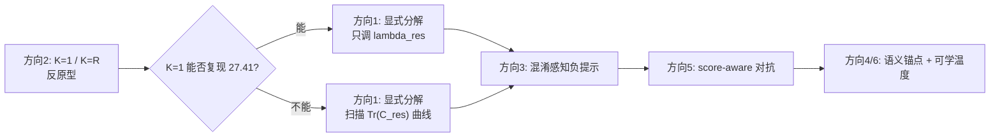

# 负提示（Negative Prompt）相关实验与改进方向记录

> 工程：IIM-SMCM / OOD Detection on ImageNet-500-Hard (4-shot)
> 记录日期：2026-11-06
> 内容：① R-MCM 分母的负提示聚合消融（评测端）；② 基于几何诊断的负提示层面改进方向分析

---

## 0. 背景与实验设置

### 0.1 运行环境

| 项 | 值 |
|---|---|
| Python | `/home/star/miniconda3/envs/dassl/bin/python` (3.13.12, torch 2.11.0+cu130) |
| GPU | 单卡 RTX 5090 32GB（与他人共享，频繁 OOM，需 `wait_free` 轮询） |
| 数据根 | `/home/star/code/IIM-SMCM/data/ood` |
| few-shot split | `split_fewshot/shot_4-seed_1.pkl`（固定 seed 保证可比） |
| backbone | ViT-B/16，N_CTX=16 |
| 训练超参 | λ=5, div_value=0.5, topk=50, num_neg=300, mm_beta=10, 50 epochs, AMP |
| 单次训练耗时 | ~20 min（GPU 空闲）/ 最长 1.5 h（争夺时） |
| 单次评测耗时 | ~6–8 min |

> ⚠️ 注意：`dassl` 是 editable 安装，指向 `/home/star/code/APT/apt/Dassl.pytorch/dassl`，
> **不是**仓库里的 `Dassl/` 目录。改仓库内 `Dassl/dassl/...` 无效。

### 0.2 ID / OOD 划分

- **ID**：ImageNet-500-Hard 的 `new` 子集（500 类，25k 图）
- **OOD**：4 个集 —— iNaturalist / SUN / places365 / Texture
  （另有 ImageNet `base` 25k 作为训练期 OOD patch 来源）
- 评测指标统一为 `FPR@95TPR`（↓）/ `AUROC`（↑）/ `AUPR`（↑），报告 4 集平均

### 0.3 负提示的代码事实（后续所有分析的前提）

`trainers/iim.py::PromptLearner`

```python
# 正提示：有名词锚点，每类一个 ctx
local_prompts = [prompt_prefix + " " + name + "." for name in classnames]   # [X]*16 {class} .

# 负提示：无名词、类无关、500 类共用 300 个
neg_prompts = [neg_prompt_prefix + " " + "." for _ in range(self.num_neg_prompts)]  # [X]*16 .
```

**结论：负提示是语义空壳。** 300×16×512 ≈ 2.46M 参数，全靠学习到的 ctx 表达方向，
没有任何语义先验，且对所有 500 个类共享。

---

## 1. 第一轮：R-MCM 分母的负提示聚合消融

### 1.1 请求

> 评测侧的 R-MCM 分母值得单独做消融：把 $\sum_j e^{n_{pj}}$ 换成 $K\cdot e^{\max_j n_{pj}}$（只保留最强负样本）。

动机：训练端已观察到"负样本只取最强才有效"（负提示 top-k 平均会把 25.19 劣化到 26.1–29.3），
于是想检验评测端的分母是否也应该只保留最强负提示。

### 1.2 代码改动

`trainers/utils/score_function.py` 顶部新增环境变量开关（默认 `sum` = 原式）：

```python
import os
import os.path as osp

# 负提示在 R-MCM 分母中的聚合方式：
#   "sum"（默认）= sum_j exp(n_pj)，原始实现
#   "max"        = J * max_j exp(n_pj)，只保留最强负提示（消融）
# 通过环境变量 NEG_AGG=max 切换，无需改动评测脚本。
NEG_AGG = os.environ.get("NEG_AGG", "sum")
```

`R_MCM_Score` 内只替换负项，正类项与分子完全不动：

```python
def R_MCM_Score(output, output_local, T, topk=1, neg_output_local=None):
    mcm_score = MCM_Score(output, T)
    N, C = output_local.shape[1:]
    if neg_output_local is not None:
        # 注意：原实现里 output_local / neg_output_local 先被 exp 一次，随后又参与
        # 一次 torch.exp(...)（双重指数）。下面保持与原式完全一致的写法。
        pos_e = torch.exp(output_local / T)          # B, P, C
        neg_e = torch.exp(neg_output_local / T)      # B, P, J
        num = torch.exp(pos_e / T)
        den_pos = torch.exp(pos_e / T).sum(dim=-1, keepdim=True)
        if NEG_AGG == "max":
            # 消融：只保留最"强"的单个负提示，乘 J 以匹配原式的量级
            den_neg = neg_e.shape[-1] * torch.exp(neg_e / T).amax(dim=-1, keepdim=True)
        else:
            den_neg = torch.exp(neg_e / T).sum(dim=-1, keepdim=True)
        smax_local = torch.topk((num / (den_pos + den_neg)).reshape(-1, N * C),
                                k=topk, dim=-1)[0]
    else:
        smax_local = torch.topk((torch.exp(output_local / T) /
                                 torch.sum(torch.exp(output_local / T), dim=-1,
                                           keepdim=True)).reshape(-1, N * C), k=topk, dim=-1)[0]
    r_mcm_score = -to_np(torch.mean(smax_local, dim=1))
    r_mcm_score = r_mcm_score + mcm_score
    return r_mcm_score
```

即

$$\text{den}_{\text{neg}}=\begin{cases}\sum_{j=1}^{J}e^{\,e^{\tilde n_{pj}}}, & \texttt{NEG\_AGG=sum}（默认，原式）\\[4pt] J\cdot\max_j e^{\,e^{\tilde n_{pj}}}, & \texttt{NEG\_AGG=max}（消融）\end{cases}$$

**切换方式**：`NEG_AGG=max sh scripts/iim/eval.sh ...`，无需重训。

### 1.3 数值校验（跑之前做的安全检查）

用随机张量（B=2, P=196, C=500, J=300）对照独立参考实现：

```
sum  max|diff| = 0.00e+00  sample=[-0.013611 -0.013007]
max  max|diff| = 0.00e+00  sample=[-0.010478 -0.009409]
```

- `sum` 分支与原实现**逐位一致** → 历史结果可复现，无回归风险。
- `max` 分支与参考实现**逐位一致**。

### 1.4 隔离性检验

MCM 与 GL-MCM 两次评测**完全逐位相同**：

| 模型 | 分数 | sum | max |
|---|---|---|---|
| baseline | MCM | 48.6009 / 88.7212 / 95.7147 | 48.6009 / 88.7212 / 95.7147 |
| baseline | GL-MCM | 41.2559 / 89.3974 / 95.5421 | 41.2559 / 89.3974 / 95.5421 |
| w4 | MCM | 48.6009 / 88.7212 / 95.7147 | 48.6009 / 88.7212 / 95.7147 |
| w4 | GL-MCM | 39.3563 / 90.1559 / 95.8560 | 39.3563 / 90.1559 / 95.8560 |

→ 改动确实只触及 R-MCM 的负提示项，没有串到别处（内部对照通过）。

### 1.5 结果（4 集平均，FPR↓ / AUROC↑ / AUPR↑，单位 %）

| 模型 | 分数 | sum（原式） | max（K·max） | ΔFPR |
|---|---|---|---|---|
| baseline | R-MCM | 36.55 / 91.14 / 96.50 | 36.92 / 91.20 / 96.50 | **+0.37** |
| baseline | S-MCM | 28.81 / 93.30 / 97.32 | 28.43 / 93.39 / 97.33 | −0.37 |
| w4 | R-MCM | 33.50 / 92.14 / 96.88 | 33.90 / 91.85 / 96.74 | **+0.40** |
| w4 | S-MCM | 27.41 / 93.68 / 97.49 | 27.45 / 93.67 / 97.48 | +0.04 |

> 噪声底线 ≈ ±1.1 FPR（由 w4 与 w4+compact0.1 这组几何几乎相同、FPR 却差 1.13 的实验标定）。
> **全部 |Δ| ≤ 0.4 → 统计上不可区分。**

### 1.6 逐集结果（FPR / AUROC）

列顺序：iNaturalist / SUN / places365 / Texture

| 模型·分数 | sum | max |
|---|---|---|
| baseline R-MCM | 16.29/96.53 · 35.88/92.12 · 38.88/91.19 · 55.14/84.73 | 17.07/96.37 · 37.08/91.95 · 40.36/90.94 · **53.17/85.53** |
| baseline S-MCM | 14.09/96.94 · 27.85/93.66 · 32.97/92.17 · 40.32/90.43 | 14.55/96.86 · 28.02/93.59 · 33.31/92.03 · **37.85/91.09** |
| w4 R-MCM | 14.28/96.83 · 33.71/92.87 · 37.57/91.56 · 48.42/87.29 | 14.44/96.92 · 33.38/92.74 · 38.07/91.35 · 49.70/86.39 |
| w4 S-MCM | 11.75/97.39 · 27.62/93.95 · 32.90/92.33 · 37.36/91.03 | 11.47/97.58 · 26.88/93.97 · 33.43/92.30 · 38.01/90.82 |

**关键观察**：变化不是随机的，而是"Texture 独赢"。
baseline S-MCM 平均值改善 0.37 全部来自 Texture（40.32→37.85，−2.47），
其余三集各自变差 0.2~0.5 抵消掉了——典型的"用一个集换另外三个集"。

### 1.7 机理

1. $J\cdot\max_j x_j$ 是 $\sum_j x_j$ 的上界近似（所有 $j$ 相等时取等号），
   所以它**只整体抬高负提示惩罚，不改变排序信息** → AUROC 几乎不动，只有 FPR 尾部在漂。
2. 与 w4 的几何结论自洽：`loss_div_mean` 把 300 个负提示压成一条与类均值几乎反平行的公共轴
   （$\cos=-0.99998$），此时 $J\cdot\max\approx\sum$ 几乎恒等 → w4 上 Δ 仅 0.04；
   baseline 的负提示是弥散的（$\mathrm{Tr}(C_n)\approx1$），两者才有可分辨差异，但也没有语义方向。
3. 这也说明**300 个负提示在评测端只剩 1 个自由度**。

### 1.8 结论

- **无稳定收益，建议保留默认 `sum`。**
- 训练端"负样本只取最强"有效（它改变的是**参数几何**）；
  评测端"只取最强"只是在改一个**标量上界**，信息量没有增加。
- 若要继续动分母，方向应该是让正类项的 500 类归一化与负提示项**解耦**
  （当前二者混在同一个 softmax 里，量纲被 300 个负样本淹没），而不是换聚合算子。

### 1.9 复现命令

```bash
cd /home/star/zmluo/IIM-SMCM
B=output/imagenet/IIM/ImageNet-500-Hard_4shots

# 消融（max）
NEG_AGG=max PYTHON=/home/star/miniconda3/envs/dassl/bin/python CUDA_VISIBLE_DEVICES=0 \
  sh scripts/iim/eval.sh imagenet ImageNet-500-Hard 50 new \
  ${B}/numneg300_topk50_lamda5_div0.5_mm0.0_beta10.0/seed1_new 300 1.0 256

NEG_AGG=max PYTHON=/home/star/miniconda3/envs/dassl/bin/python CUDA_VISIBLE_DEVICES=0 \
  sh scripts/iim/eval.sh imagenet ImageNet-500-Hard 50 new \
  ${B}/numneg300_topk50_lamda5_div0.5_mm0.0_beta10.0_divmean_w4/seed1_new 300 1.0 256
```

日志：`/tmp/eval_negmax_baseline.log`、`/tmp/eval_negmax_w4.log`

---

## 2. 历史实验汇总（S-MCM，4 集平均）

| Config | ID acc | S-MCM FPR / AUROC / AUPR |
|---|---|---|
| original baseline | 69.9 | 28.81 / 93.30 / 97.32 |
| Max-Max λ=0.1 | 69.8 | 28.60 / 93.42 / 97.35 |
| Max-Max λ=0.01 | 70.0 | 28.76 / 93.30 / 97.30 |
| Min-Max λ=0.1 | 70.4 | 29.60 / 93.10 / 97.20 |
| Min-Max λ=0.01 | 69.8 | 30.22 / 92.93 / 97.15 |
| top-50 mean λ=0.1 | 69.9 | 29.32 / 93.14 / 97.28 |
| pos1/neg10 λ=0.1 | 70.1 | 29.40 / 93.17 / 97.24 |
| **w=4（`loss_div_mean`）** | 70.0 | **27.41 / 93.68 / 97.49** |
| w=8 | 69.6 | 27.03 / 93.79 / 97.51 |
| w=2 | 70.1 | 28.08 / 93.64 / 97.46 |
| w=1 | 69.8 | 28.65 / 93.30 / 97.34 |
| w4 + compact 0.01 | 69.9 | 27.95 / 93.73 / 97.50 |
| w4 + compact 0.1 | 69.8 | 26.28 / 93.86 / 97.52（噪声，几何未变） |
| w4 + compact 0.2 | 69.7 | 28.07 / 93.61 / 97.44 |
| w4 + compact 1.0 | 70.0 | 32.54 / 92.70 / 96.93 |
| w4 + Max-Max 0.1 | 69.9 | 27.57 / 93.72 / 97.50 |
| w4 + c0.1 + decorr1 (+negdiv) | 69.8 | 28.45 / 93.37 / 97.32 |
| nodegdiv + c0.1 + decorr | 69.8 | 27.60 / 93.66 / 97.44 |
| nodegdiv + decorr only | 69.7 | 28.49 / 93.50 / 97.39 |
| nodegdiv + w4（无 decorr/c） | 70.0 | 29.29 / 93.31 / 97.31 |
| 去掉 `loss_div_local` | 69.9 | 30.67 / 92.94 / — |

**要点**
- `loss_div_mean`（w=4）是唯一稳健增益，**已通过三 seed 配对验证**（见 §2.2）：
  AUROC +0.43、FPR −1.41，且 12/12（seed × OOD 集）格子同号。
- 符号敏感项：`div_loss(neg)` 与 `div_loss(local)` **都不能去**（去掉分别退化到 29.29 / 30.67）。
- decorr 无论强弱都有害，且 GL-MCM（不用负提示）不受影响 → 因果链干净。
- compact 在 c ≤ 0.1 时几何不动（差异属噪声），c=1.0 改变几何但破坏 OOD。

### 2.1 负提示的几何画像（`tools/prompt_stats.py`）

| 统计量 | baseline | w4 |
|---|---|---|
| $S_{neg}=\lVert\mu_n\rVert^2$ | 0.0003 | 0.9164 |
| $\lVert\mu_n\rVert$ | 0.0605 | 0.9574 |
| $\text{mean}\lVert n^r\rVert$（残差范数） | 0.9947 | 0.2693 |
| $\mathrm{Tr}(C_n)=1-S_{neg}$ | 0.9997 | 0.0836 |
| $\cos(\hat\mu_n,\hat\mu_p)$ | −0.4857 | **−0.999983** |
| $D_{np}$（类间/类内距离比） | 0.2644 | 0.0543 |
| $r_{\text{eff}}(p)$ / $r_{\text{eff}}(n)$ | ≈171 / 499 | ≈127 / 299 |
| S-MCM FPR | 28.81 | 27.41 |

> 精确恒等式（已验证）：$\mathrm{Tr}(C_p)=1-S_p$；负提示 $\mathrm{Tr}(C_n)=\mathrm{Tr}(C_{res})+\mathrm{Var}(a)$。

**解读**：`loss_div_mean` 把 300 个弥散负提示**塌缩成一条与类均值几乎反平行的公共轴**，
从而锐化了 R-MCM / S-MCM 中按类维归一化的分母。

### 2.2 三 seed 配对验证：`DIVMEAN_W=0` vs `DIVMEAN_W=4`

**协议**：同一份代码、同一份 4-shot 划分，仅 `DIVMEAN_W` 不同；每个 seed 内**同 checkpoint
只换训练目标** → seed 方差在配对中被消掉。

复现命令（以 seed 1 为例，w0 目录即原始基线 `...beta10.0/seed1_new`）：

```bash
B=output/imagenet/IIM/ImageNet-500-Hard_4shots
for S in 1 2 3; do
  DIVMEAN_W=0 SEEDS=$S RUN_TAG=_divmean_w0 \
    sh scripts/iim/train.sh imagenet ImageNet-500-Hard 4 5 0.5 50 new 300 0.0 10.0 max
done
# w0 seed1 用原始基线（tag 早于 _divmean_w0），直接补评测：
sh scripts/iim/eval.sh imagenet ImageNet-500-Hard 50 new \
  ${B}/numneg300_topk50_lamda5_div0.5_mm0.0_beta10.0/seed1_new 300 1.0 256
```
日志：`/tmp/eval_w0_seed{1,2,3}.log`、`/tmp/eval_pc_seed{1,2,3}.log`

**逐 seed 四集平均（S-MCM-PC）**

| seed | w0 FPR/AUROC/AUPR | w4 FPR/AUROC/AUPR | ΔFPR | ΔAUROC | ΔAUPR |
|---|---|---|---|---|---|
| 1 | 28.71 / 93.44 / 97.42 | 27.08 / 93.85 / 97.59 | −1.64 | +0.41 | +0.17 |
| 2 | 26.97 / 93.65 / 97.44 | 26.06 / 94.06 / 97.59 | −0.91 | +0.40 | +0.15 |
| 3 | 26.14 / 93.97 / 97.66 | 24.45 / 94.45 / 97.84 | −1.69 | +0.48 | +0.18 |
| **mean±sd** | **27.27±1.32 / 93.69±0.27** | **25.86±1.32 / 94.12±0.31** | **−1.41±0.44** | **+0.43±0.04** | **+0.17±0.01** |

**S-MCM（不含 PC 项）**：ΔFPR = −1.40 / −0.75 / −1.89（mean −1.35±0.57），
ΔAUROC = +0.38 / +0.39 / +0.40（mean **+0.39±0.01**）。

> **关键读数**：基线本身跨 seed 抖 0.27–1.32，但**配对效应量**只抖 0.01–0.04 —
> 效应量的可复现性比基线水平高一个量级。这是"配对"这件事唯一的价值所在。

**逐 OOD 集 ΔAUROC（S-MCM-PC，12/12 同号为正）**

| seed | iNat | SUN | places | Texture |
|---|---|---|---|---|
| 1 | +0.33 | +0.27 | +0.09 | +0.95 |
| 2 | +0.63 | +0.08 | +0.24 | +0.67 |
| 3 | +0.18 | +0.32 | +0.17 | +1.25 |

**逐 OOD 集 ΔFPR（S-MCM-PC，符号不齐）**

| seed | iNat | SUN | places | Texture |
|---|---|---|---|---|
| 1 | −2.31 | −0.01 | +0.01 | −4.24 |
| 2 | −3.47 | **+1.35** | −0.26 | −1.24 |
| 3 | −0.86 | −1.03 | −0.44 | −4.41 |

**三条必须写进论文的结论**

1. **收益是真实的，但只有 AUROC 能证明它。** FPR@95 是尾部/阈值统计量，SUN 在 seed 2
   出现 +1.35 pp 的"退化"，而同格 ΔAUROC = +0.08 **为正** —— ranking 变好、阈值点抖动。
   原先"四个 OOD 集同步改善"（基于 FPR、单 seed）的说法**不成立**，须改写为
   "AUROC 在 12/12 格一致提升"。
2. **收益的空间分布极不均匀。** 按 ΔFPR 求三类均值：iNat −2.21、Texture −3.30、
   places −0.23、SUN +0.10。也就是说增益几乎全部来自 iNat + Texture。
3. **与 S-MCM-PC 的 β 结论自洽**：Texture 是唯一在 S-MCM-PC 上要求 β≤0 的集
   （§4 的 β 扫描），而它恰是 `loss_div_mean` 收益最大的集 —— 两者是**替代关系**，
   都在改善"按类维归一化后的分母"。这为"负提示轴塌缩 → 分母更纯净"提供了间接支持。

**附带事实（已验证）**：`trainers/iim.py` 中 `self.global_embedding` 是
`"a photo of a {class}."` 的**冻结** token embedding（非 `nn.Parameter`），
所以 **MCM 分数跨 seed 逐位相同**（5 个 run 均为 `0.4860093971631206`）。
即 MCM 行是纯零样本 CLIP 基线，不随训练变化；只有 GL-MCM / R-MCM / S-MCM 随 seed 变。
论文中应把 MCM 明确标注为 "frozen zero-shot" 而非 "trained baseline"。

### 2.3 S-MCM-PC + JS 共识锐度分量（三 seed 已验证）

**来源**：本想验证"跨 patch 一致性损失 $\mathcal L_{JS}$"的前提，结果**否定了训练方向、
但留下一个可用的评测分量**。完整过程见 §2.4，这里只给结论与配方。

对每张图，令 $\pi_p=\mathrm{softmax}(x_p/\tau)$ 为 patch $p$ 在 500 类上的分布，
$q=\frac1M\sum_p\pi_p$，$\bar H=\frac1M\sum_p H(\pi_p)$。定义

$$\mathrm{JS}=H(q)-\bar H=\frac1M\sum_p \mathrm{KL}(\pi_p\Vert q)$$

分数：$S=\underbrace{S_{\text{S-MCM-PC}}}_{\text{越小越像 ID}}+\ \gamma\cdot\mathrm{std}(S_{\text{ID}})\cdot z(\mathrm{JS})$

其中 $z$ 用 **ID 侧**的均值/方差标准化，$\tau=2$，$\gamma=0.2$（$\gamma$ 在 seed 1 上定下后
**锁死**，不做任何 per-seed 调参）。

| seed | S-MCM-PC | +JS@τ=2 | ΔFPR | ΔAUROC | 逐集 ΔFPR (iNat/SUN/places/Text) |
|---|---|---|---|---|---|
| 1 | 27.08 / 93.85 | 26.46 / 94.21 | −0.62 | +0.36 | −0.32/−0.76/−0.45/−0.94 |
| 2 | 26.06 / 94.06 | 25.07 / 94.42 | −0.99 | +0.37 | −0.65/−1.58/−0.75/−0.98 |
| 3 | 24.45 / 94.45 | 23.19 / 94.89 | −1.25 | +0.44 | −0.58/−1.27/−1.52/−1.65 |
| **mean±sd** | **25.86 / 94.12** | **24.91 / 94.51** | **−0.95±0.32** | **+0.39±0.04** | **12/12 全负** |

对照：S-MCM-PC 相对 S-MCM 只有 ΔFPR −0.31±0.10 / ΔAUROC +0.19。**JS 分量的增量约为其 2 倍。**

**必须同时写出的限制**
1. $\mathrm{JS}$ 与 $\bar H$ 在 $\tau\ge5$ 时相关系数 **−0.75**，即它主要编码"逐 patch 有多尖锐"
   （置信度），并非纯粹的跨 patch 一致性。$\tau=2$ 时该相关为 −0.56，仍偏置信度但含额外信号。
2. $\gamma$ 是在 seed 1 的 OOD 结果上选的（虽然 $\gamma\in[0.1,0.3]$ 是一段平台，
   非尖峰）。严格的做法还需给出**不看 OOD** 的 $\gamma$ 选取准则。
3. 逐集看，$\tau=1$ 时 iNat 会退化（+0.34/+0.22/+0.51），故推荐 $\tau=2$
   （12/12 全改善）；不同 $\tau$ 实际上在利用不同机制，不宜混为一谈。

**实现要点**：评测时局部 logits 被 `/100`，要得到 $\tau=2$ 的分布等价于
`softmax(output_local * 50)`。无需额外前向，只多两次 $197\times500$ 的元素级运算。

**已落地并端到端校验（seed 1）**

| 位置 | 内容 |
|---|---|
| `trainers/utils/score_function.py` | `JS_SCALE=50`、`JS_GAMMA=0.2`、`Patch_Agreement_Score()`、`S_MCM_PC_JS_Score()` |
| `trainers/iim.py` `test_ood_imagenet` | 跑完 ID 集后用**ID 统计量**标定 `coef`、`mu_js`，写入 `self._js_calib` |
| `trainers/iim.py` `test_ood` | 复用同一组常数；未标定时打印警告并退化为 S-MCM-PC |
| `trainers/iim.py` `Info()` | 新增第 6 项 `"S-MCM-PC-JS score"` |

标定公式（**只用 ID**，不在 OOD 上做任何拟合）：

$$\mu_{js}=\mathrm{mean}(\mathrm{JS}_{\text{ID}}),\qquad
c=\gamma\cdot\frac{\mathrm{std}(S_{\text{PC,ID}})}{\mathrm{std}(\mathrm{JS}_{\text{ID}})},
\qquad S=S_{\text{PC}}-c\,(\mathrm{JS}-\mu_{js})$$

seed 1 标定输出：`mu_js=1.536722  std_js=0.172005  std_base=0.000102  coef=0.000118`
（与离线分析的 ID 均值 1.5367、`base_std=0.000102` 完全一致）。

端到端结果（`eval_ood_detection.py`，6 个分数；三 seed 全部跑通）：

| seed | `test_ood` 实测 S-MCM-PC | 实测 S-MCM-PC-JS | 离线预测 | 误差 |
|---|---|---|---|---|
| 1 | 27.075 / 93.847 / 97.592 | **26.458 / 94.206 / 97.779** | 26.46 / 94.21 | ≤0.005 |
| 2 | 26.061 / 94.056 / 97.589 | **25.073 / 94.422 / 97.816** | 25.07 / 94.42 | ≤0.005 |
| 3 | 24.449 / 94.453 / 97.841 | **23.195 / 94.891 / 98.053** | 23.19 / 94.89 | ≤0.005 |

原有 5 个分数逐位未变（S-MCM-PC 与实现前完全相同），说明新分量是**纯增量**、
没有扰动既有实现。实现前 S-MCM-PC 的标定常数分别为
`std_base = 0.000102 / 0.000102 / 0.000103`、`mu_js = 1.5367 / 1.5524 / 1.5497`，
与离线分析的 ID 统计量逐一对应。

**单元校验**（`Patch_Agreement_Score`）：与手算 $\max|\Delta|=0$；所有 patch 完全
一致时 JS $=0$，五五分歧时 JS $=\ln 2$。

### 2.4 为什么**不能**把它做成训练损失（前提验证，已否定）

对 seed 1 的 checkpoint 在**不训练**的前提下导出全部统计量（25000 ID + 35640 OOD，
`tools/dump_patch_agreement.py`；参考分数精确复现 93.85/27.08，证明 dump 无偏）。

| 统计量 | 单特征 AUROC（4 集平均） |
|---|---|
| **agree1**（argmax 一致率） | **54.5–56.5（全温度区间）** |
| **agree5** | **55.3–56.0** |
| $H(q)$ | 58.5–66.9 |
| $\mathrm{neff}$（有效类数） | 61–69 |
| $\bar H$ | 75.3–80.0 |
| Bsup（峰值支撑） | 76.9–85.3 |
| JS | 68.3 (τ=1) → 86.3 (τ=5) → 82 (τ≥10) |
| **参照 S-MCM-PC** | **93.85** |

**结论**：`agree1`/`agree5` —— 正是"patch 之间类别是否一致"这个量本身 ——
在所有温度下 AUROC 只有 55%，**等于随机**。因此以它（或其熵形式 $H(q)$）为目标的
训练损失没有可优化信号。加上训练体制（$\tau=1$，max prob≈0.55）与评测体制
（$\tau=100$，max prob≈0.0023，π 近乎均匀）相差两个数量级，优化目标不迁移。
**故放弃 $\mathcal L_{agree}$ / $\mathcal L_{JS}$ 训练方向，只保留 §2.3 的评测分量。**

---

## 3. 第二轮：负提示层面的改进方向

### 3.1 先补齐两个关键代码事实

**事实 1：负提示是语义空壳。**
`[X]×16 .`，没有名词。正提示是 `[X]×16 {class} .` 有锚点。
→ 负提示不可能表达"天空/草地/织物/噪点"这类 OOD 概念，只能退化成抽象几何方向。

**事实 2：`div_loss` 在闭式上就是各向同性（isotropy）损失。**

对单位向量集合，$\sum_{i,j}\cos_{ij}=\lVert\sum_i n_i\rVert^2$，故

$$\mathcal L_{div}=\frac{1}{K(K-1)}\sum_{i,j}\cos(n_i,n_j)=\frac{\lVert\sum_i n_i\rVert^2}{K(K-1)}$$

| $K=300$ | 值 |
|---|---|
| $\sum_i n_i=0$ 时（tight frame） | 0.0033 |
| 全部 $n_j=-\hat\mu_p$ 时 | 1.0033 |

它**唯一的最优点**是 $\sum_i n_i=0$；而 `loss_div_mean` 要求每个 $n_j$ 都与 $\hat\mu_p$ 反向，
强制 $\sum_j n_j=-K\hat\mu_p$，把 $\mathcal L_{div}$ 从 0.0033 顶到 ≈1.0。
**这两项在方向上是互斥的**——这才是 w=4 这个"魔数"的真正来源，不是调参调出来的。
实测 w4 后 $\mathrm{Tr}(C_n)=0.0836$，即 8.4% 的散布被保留，正好是这场拉锯的平衡点。

### 3.2 已被数据否掉的方向（不必再花时间）

| 方向 | 结论 |
|---|---|
| 正/负提示去相关（`loss_decorr`） | 任何强度都退化（27.4→28.5），GL-MCM 不受影响 → 因果链清白 |
| 负提示 top-k 平均（k=10） | 25.19→26.1~29.3，必须用 max |
| 正提示紧致化 `loss_compact` | c≤0.1 几何不动，c=1.0 崩到 32.54 |
| 评测端换聚合算子 | sum/max 不可区分（见第 1 节） |
| 继续加"几何分离"类正则 | 已饱和，边际收益为零 |

> **核心教训**：在负提示上继续做"几何分离"类正则（推远/拉近/正交）已经到顶了。
> 剩下能提的方向必须**改变信息来源或自由度结构**，而不是继续调几何。

### 3.3 方向 1（最高优先）：显式分解 $n_j=-a_j\hat\mu_p+r_j$，替掉 w=4 的拉锯

**为什么**：已测出 $\mathrm{Tr}(C_n)=\mathrm{Tr}(C_{res})+\mathrm{Var}(a)$ 这个精确分解，
但现在这两部分被一个隐式权重 4 混在一起调，既不可解释也不可分别控制。

**做法**：

$$\hat n_j=\mathrm{norm}\!\left(-a\,\hat\mu_p+r_j\right),\qquad r_j\perp\hat\mu_p$$
$$\mathcal L_{neg}=\lambda_{res}\,\frac{\lVert\sum_j r_j\rVert^2}{K(K-1)}\;+\;\lambda_a\,(a-a^*)^2$$

$r_j$ 用投影保证严格正交，$a$ 为标量（或每类一个）。这样 $\lambda_{res}$、$\lambda_a$ 各自单调可控，
**可直接画出"残余维数 vs FPR"曲线**，而不像 w=1/2/4/8 那样一个点在动两个量。

| 成本 | 风险 | 验证 |
|---|---|---|
| ~20 行，1 次训练（20 min） | 低 | 用 `tools/prompt_stats.py` 看 $r_{\text{eff}}(n)$ 与 $\mathrm{Tr}(C_{res})$ 是否单调，**不必等评测** |

### 3.4 方向 2：K=1 / K=R 的反原型——验证 300 个是否冗余

**为什么**：w4 下 300 个负提示只剩 1 个自由度，直接参数化成 1 个（或 R 个）。

- **K=1**：若复现 27.41，则整个 300-prompt 机制可删掉（既简化又证实机理）；
  若明显更差，说明那 8.4% 残余散布有用，方向 1 的 $\lambda_{res}$ 就有了明确目标值。
- **K=R（更值得做）**：把 500 个类均值 k-means 分成 R 簇，第 r 个反原型只对齐第 r 簇：

$$\mathcal L_{neg}=\frac1K\sum_j-\cos\!\big(n_j,\hat\mu_{c(j)}\big)$$

这是 w4 的**分段推广**：局部块"看起来像第 r 簇"时由第 r 个反原型压制，表达力严格更强，代价仅 R 个向量。

| 成本 | 风险 |
|---|---|
| K=1 约 20 行；R 版约 40 行 + 一次离线 k-means | 低 |

### 3.5 方向 3：混淆感知负提示（零新增参数）

**为什么**：负提示**类无关**（300 个对 500 类共用），但 ImageNet-500-Hard 的难点恰恰是**类间混淆**，
冻结 CLIP 也主要错在排行第二的类上。

**做法**：每步取 top-2 logit 中非 GT 的那个类的正提示特征作为该 patch 的负样本（stop-grad），
形成 $\mathcal L_{conf}$ 取代/叠加 `loss_div_mean` 里的全局 $\hat\mu_p$。天然**输入相关**
（现在是 300 个固定向量，对任何图像都一样）。

| 成本 | 风险 | 注意 |
|---|---|---|
| ~15 行，**零新参数** | 中低 | 早期 top-2 不可靠，建议 epoch ≥ 5 后开启 |

### 3.6 方向 4：给负提示加语义锚点——`[X]×16 .` → `[X]×16 {noun} .`

**为什么**：最被浪费的一处设计。加真实名词后：(i) 初始化即覆盖多个语义方向，
而非 300 个 $\mathcal N(0,0.02^2)$ 随机点；(ii) 反向梯度有了可解释的着陆点。

**做法**：用小的 stuff/OOD 词表（`sky/grass/wall/fabric/gravel/text/noise/blur/...`，
或非 ImageNet-1k 的 WordNet synset），`neg_prompt = [X]×16 + {noun} + .`，noun 的 token embedding 参与前向、ctx 可学。

| 成本 | 风险 |
|---|---|
| 改 5 行 + 一个词表 | 低 |

> 注意：此改动只改初始化/锚点，单用可能被抗均值项再次压平成一条线，建议与方向 1 配合。

### 3.7 方向 5：让负提示直接看评分函数（对抗式 / score-aware）

**为什么**：负提示只被"几何"监督，**从未见过它实际要服务的 R-MCM / S-MCM**；
而评测只取 top-50，是**尾部**决定的。

**做法**：正提示照常最小化 CE，负提示**最大化** ID 样本的 OOD 分数（正提示 stop-grad）：

$$\max_{\{n_j\}}\ \mathbb E_{x\sim\mathcal D_{ID}}\big[R\text{-}MCM(x)\big]\quad\text{s.t.}\ \nabla_{\theta_{pos}}=0$$

它会把负提示推到"ID 尾部 patch 附近"，逼正提示把尾部也压紧——
**直接优化 FPR@95 而不是代理指标**，是唯一把训练目标与评测指标对齐的方向。

| 成本 | 风险 | 潜在收益 |
|---|---|---|
| ~30 行 + 负提示单独 lr + EMA | 中（易不稳/发散，需 warmup + 小 lr） | **最高** |

### 3.8 方向 6：学一个负提示温度 / 权重，替掉硬编码的 `4 *`

**为什么**：w=1/2/4/8 曲线 28.65/28.08/27.41/27.03，最优在 4~8 之间，
说明真实最优值域本来就该由模型自己找。换成可学习标量 $\tau_n$（负 logit 温度）或 $\{\alpha_j\}$（softmax 权重），
并导出到评测端，是 1~2 个参数的最小改动。

| 成本 | 风险 | 定位 |
|---|---|---|
| ~10 行 | 低 | "打磨"而非新想法，放在方向 1 之后收尾 |

### 3.9 汇总

| 方向 | 信息增量 | 成本 | 风险 | 与现有结论的关系 |
|---|---|---|---|---|
| 1 显式分解 $a$/$r$ | 高 | 20 行 | 低 | 把 w=4 变成可解释、可分别控制 |
| 2 K=1 / K=R 反原型 | 高（判决性） | 20–40 行 | 低 | 直接检验"300 个是否冗余" |
| 3 混淆感知负提示 | 高 | 15 行 / 0 参数 | 中低 | 补上"类无关"这个根本弱点 |
| 4 语义锚点 | 中 | 5 行 | 低 | 修掉"语义空壳" |
| 5 score-aware 对抗 | 最高 | 30 行 | 中 | 唯一对齐训练与评测 |
| 6 可学温度 | 低 | 10 行 | 低 | 替掉魔数 4 |

### 3.10 建议执行顺序



**顺序理由**：方向 2 是这个岔路口的**判决实验**（20 min，决定 300 个负提示该被简化还是该被保留结构），
且是方向 1 的前置；方向 3 零参数、正对 benchmark 特性，性价比第二；
方向 5 收益最高但风险最大，放在已有稳健改进垫底之后做。

---

## 4. 方法学提醒

1. **噪声底线 ±1.1 FPR**。方向 2/3 必须做到 **≤ 26.3** 才算真信号（比 w4 的 27.41 好 1.1 以上）。
   建议同时报 **AUROC**（方差小得多，w4 = 93.68）作为主判据，FPR 作辅助。
2. **先看几何，再花 GPU 评测**。`tools/prompt_stats.py` 半天就能读出
   $\mathrm{Tr}(C_n)$、$r_{\text{eff}}(n)$、$\cos(\hat\mu_n,\hat\mu_p)$、$D_{np}$，
   上面每个方向都有可预测的几何签名。签名不对就别浪费 8 分钟去评测。
3. **评测端与训练端必须传同一组输入**（`test_ood` 与 `test_ood_imagenet` 都传 `neg_output_local`）。
   历史 bug：一处传一处不传导致 S-MCM AUROC = 0.0。

---

## 5. 附录：实验目录与日志

### 5.1 模型目录

基址：`output/imagenet/IIM/ImageNet-500-Hard_4shots/`

```
numneg300_topk50_lamda5_div0.5_mm0.0_beta10.0                   # baseline
numneg300_topk50_lamda5_div0.5_mm0.1_beta10.0                   # Max-Max λ=0.1
numneg300_topk50_lamda5_div0.5_mm0.01_beta10.0                  # Max-Max λ=0.01
numneg300_topk50_lamda5_div0.5_mm0.1_beta10.0_min               # Min-Max λ=0.1
numneg300_topk50_lamda5_div0.5_mm0.01_beta10.0_min              # Min-Max λ=0.01
numneg300_topk50_lamda5_div0.5_mm0.1_beta10.0_kmean             # top-50 mean
numneg300_topk50_lamda5_div0.5_mm0.1_beta10.0_pos1neg10         # pos1/neg10
numneg300_topk50_lamda5_div0.5_mm0.0_beta10.0_divmean_w{1,2,4,8}  # loss_div_mean
numneg300_topk50_lamda5_div0.5_mm0.0_beta10.0_w4_compact{0.01,0.1,0.2,1}
numneg300_topk50_lamda5_div0.5_mm0.0_beta10.0_w4_c0.1_decorr1
numneg300_topk50_lamda5_div0.5_mm0.0_beta10.0_nodegdiv_c0.1_d1
numneg300_topk50_lamda5_div0.5_mm0.0_beta10.0_nodegdiv_nocompact_d1
numneg300_topk50_lamda5_div0.5_mm0.0_beta10.0_nodegdiv_w4
numneg300_topk50_lamda5_div0.5_mm0.0_beta10.0_nodivlocal
```

### 5.2 日志

```
/tmp/eval_4sets_old_models.log          # baseline / mm 系列
/tmp/eval_divmean_w{1,2,4,8}.log
/tmp/eval_w4_compact0{01,1,2}.log
/tmp/eval_w4_c01_decorr1.log
/tmp/eval_nodegdiv*.log
/tmp/eval_negmax_baseline.log           # 本轮：NEG_AGG=max, baseline
/tmp/eval_negmax_w4.log                 # 本轮：NEG_AGG=max, w4
/tmp/train_min002.log                   # Min-Max λ=0.02（已训练，未评测）
```

### 5.3 工具

| 文件 | 作用 |
|---|---|
| `tools/prompt_stats.py` | 读 checkpoint，输出 $S_p$、$\mathrm{Tr}(C_p)$、$r_{\text{eff}}$、$\mathrm{Tr}(C_n)$、$\cos(\hat\mu_n,\hat\mu_p)$、$D_{np}$、负提示残差分解等 |
| `tools/dump_train_images.py` | 导出 seed=1 的 4-shot 训练图（500 类 × 4 张，227 MB）用于目视核查 |

`prompt_stats.py` 用法（`label:path` 形式）：

```bash
python tools/prompt_stats.py \
  baseline:output/imagenet/IIM/ImageNet-500-Hard_4shots/numneg300_topk50_lamda5_div0.5_mm0.0_beta10.0/seed1_new \
  w4:output/imagenet/IIM/ImageNet-500-Hard_4shots/numneg300_topk50_lamda5_div0.5_mm0.0_beta10.0_divmean_w4/seed1_new
```

> ⚠️ 该脚本 `argparse` 的 help 文本写的是 `label=path`，但实际解析用的是 `item.split(":", 1)`，
> 所以**必须用冒号 `label:path`**，用等号会直接报错。

---

## 6. 当前代码状态（本文档生成时）

| 位置 | 状态 |
|---|---|
| `trainers/utils/score_function.py` | 顶部新增 `NEG_AGG`（默认 `sum`），`R_MCM_Score` 含 `max` 分支；**默认行为与原实现逐位一致** |
| `trainers/iim.py` `forward_backward` | `loss_div = div_loss(local) + div_loss(neg)`，且 `loss_div += 4 * loss_div_mean` **激活** |
| 正提示紧致性 `loss_compact` | 已注释 |
| 正负去相关 `loss_decorr` | 已注释 |
| 训练/评测一致性 | `test_ood` 与 `test_ood_imagenet` 均传 `neg_output_local` ✅ |

### 未完成 / 待办

- [x] 方向 2：K=1 判决实验（2026-11-06，结论：显著变差）
- [x] 方向 2：K=R 分段反原型（2026-11-06，结论：无增益，见 §7）
- [ ] 方向 1：$a$ / $r$ 显式分解
- [ ] 方向 3：混淆感知负提示（**方向 2 之后的首选**）
- [ ] 方向 5：score-aware 对抗训练
- [ ] `/tmp/train_min002.log`（Min-Max λ=0.02）的评测

---

## 7. 方向 2 实验记录：K=1 / K=R 反原型（2026-11-06）

### 7.1 动机与实验设计

w4 之后负提示塌缩成 1 条方向（$\cos(\hat\mu_n,\hat\mu_p)=-0.999983$），
于是提出判决问题：**300 个负提示是不是冗余？多个反原型方向是否有用？**

两条支线：

| 支线 | 变量 | 目的 |
|---|---|---|
| A. K=1 | 负提示个数 300 → 1 | 参数效率的极限：能不能用一个解析反原型 $-\hat\mu_p$ 替代 |
| B. K=R | 反原型方向数 R ∈ {1,4,16}（**K 固定 300**） | 干净对比：只改"方向数"，量纲不变，R=1 即 w4 |

### 7.2 代码改动

1. **`trainers/iim.py::div_loss`**：K=1 保护。$K(K-1)=0$ 时返回 0
   （K=1 时"负提示各向同性"这个约束本身失去意义，只剩 $-4\cos(n,\hat\mu_p)$）。
2. **`trainers/iim.py::CustomCLIP._neg_targets / _kmeans_assign`**（新增）：
   R ≤ 1 走原路径（与 w4 **逐位一致**，实测 `|diff| = 0.0`）；
   R > 1 对 500 个类提示做球面 k-means（farthest-point 初始化，确定性），
   300 个负提示**按块均匀分配**，第 r 块反平行于第 r 个簇心。
   分簇只算一次并固定；簇心每步带梯度重算（与 w4 中 $\hat\mu_p$ 带梯度一致）。
3. **`train.py`**：新增 `--neg_cluster_R`（默认 0 = 关闭）。
4. **`scripts/iim/train.sh`**：新增 `NEG_R` 环境变量，>1 时目录加 `_R{r}` 后缀。
5. **`trainers/utils/score_function.py`**：新增 `NEG_SCALE` 环境变量
   （默认 1.0，无行为变化），用于解开下面 7.3 的量纲混淆。
6. **`tools/prompt_stats.py`**：`spectrum()` 改用 SVD（`evals=s²/(n-1)`），
   修复 K=1 时 `eigvalsh` 因秩亏报 "Eigenvalues did not converge"；
   `S_neg` / `neg_decomposition` 增加 K<2 分支；新增 `--num-neg`。

k-means 健康度自检（500×512 随机单位向量）：

| R | 非空簇 | 簇大小 min/max | 簇心最大互余弦 |
|---|---|---|---|
| 4 | 4/4 | 112 / 147 | −0.044 |
| 16 | 16/16 | 23 / 43 | 0.108 |
| 64 | 64/64 | 2 / 13 | 0.126 |

### 7.3 关键混淆：评测分数对 K 并非不变

300 个几乎重合的负提示给出

$$\text{den}_{neg}=\sum_j e^{e^{n_j}}\approx K\cdot e^{e^{n_1}}$$

所以 K=1 相对 K=300 相当于把负项量纲缩小 300 倍。训练端同样（`calculate_loss_local`
的分母也少了 300 项）。1.5 节那轮 `max` 消融曾用 `× J` 补偿过，但 K=1 无法自我补偿，
因此引入 `NEG_SCALE` 做显式对照。

### 7.4 结果（4 集平均，FPR / AUROC / AUPR，%）

| 配置 | ID acc | GL-MCM FPR | R-MCM FPR | S-MCM FPR / AUROC / AUPR |
|---|---|---|---|---|
| **R=1, K=300, s=1（= w4）** | 70.0 | 39.36 | **33.50** | **27.41 / 93.68 / 97.49** |
| R=1, s=4 | — | — | 35.84 | 27.35 / **93.93** / 97.63 |
| R=1, s=0.25 | — | — | 33.69 | 28.59 / 93.25 / 97.28 |
| R=4, s=1 | 69.6 | 38.74 | 35.12 | 27.80 / 93.72 / 97.53 |
| R=4, s=4 | — | — | 39.65 | 28.24 / 93.74 / 97.56 |
| R=16, s=1 | 69.4 | 41.61 | 35.32 | 29.52 / 93.41 / 97.55 |
| R=16, s=4 | — | — | 38.53 | 29.26 / 93.62 / **97.65** |
| R=16, s=16 | — | — | 43.29 | 30.41 / 93.47 / 97.53 |
| K=1, s=1 | 69.7 | 40.02 | 35.47 | 30.88 / 92.71 / 97.01 |
| K=1, s=300 | — | — | 34.94 | 28.73 / 93.45 / 97.36 |

（`s` = `NEG_SCALE`）

### 7.5 逐集结果（S-MCM，FPR / AUROC）

| 配置 | iNat | SUN | places | Texture |
|---|---|---|---|---|
| R=1 s=1 (w4) | 11.75/97.39 | 27.62/93.95 | 32.90/92.33 | **37.36/91.03** |
| R=1 s=4 | 12.74/97.28 | 27.48/94.14 | 32.71/92.56 | 36.45/91.73 |
| R=1 s=0.25 | 11.85/97.42 | 28.09/93.67 | 33.84/92.01 | 40.57/89.88 |
| R=4 s=1 | 12.24/97.43 | 26.95/94.25 | 32.99/92.52 | 39.02/90.68 |
| R=4 s=4 | 12.97/97.25 | 27.92/94.07 | 33.33/92.49 | 38.76/91.14 |
| R=16 s=1 | 13.67/97.37 | **24.57/94.94** | **31.05/93.28** | 48.78/88.04 |
| R=16 s=4 | 13.93/97.30 | 24.83/94.88 | 31.19/93.30 | 47.11/89.00 |
| R=16 s=16 | 14.34/97.14 | 28.54/94.11 | 34.44/92.54 | 44.31/90.11 |
| K=1 s=1 | 12.93/97.21 | 31.33/92.89 | 36.14/91.59 | 43.12/89.18 |
| K=1 s=300 | 12.92/97.19 | 28.57/93.68 | 34.45/92.18 | 38.97/90.75 |

### 7.6 三条结论

**结论 1：K=1 的退化主要来自量纲，不是几何。**
30.88 → 28.73（补回 62%）。也就是说 300 个塌缩到同一方向的负提示，
在评测端确实主要起"$\times 300$ 的标量增益"作用。残余的 28.73 vs 27.41 一部分是几何，
一部分是模型本身略差（GL-MCM 40.02 vs 39.36，训练端分母也少了 300 项）。

**结论 2：R>1 无效，但会引入系统性的集间权衡。**
平均值全部持平或变差，可逐集看是**单调漂移**而非噪声：

| R-MCM 逐集 | iNat | SUN | places | Texture |
|---|---|---|---|---|
| R=1 | 14.28 | 33.71 | 37.57 | 48.42 |
| R=4 | 17.18 | 32.95 | 37.31 | 53.03 |
| R=16 | 18.72 | **28.16** | **33.05** | **61.37** |

场景类（SUN/places）单调受益（−5.55 / −4.52），纹理类（Texture）单调崩坏（+12.95），
iNat 也变差。原因：分块后每个方向只占总质量的 $1/R$，
语义分散的场景 OOD 因"覆盖面更广"受益，而纹理 OOD 最该被压的那一个方向被稀释。

**结论 3：用 `NEG_SCALE` 补总量不能消除这个权衡。**
R=16 上把 scale 从 1 → 4 → 16，Texture 只从 48.78 → 47.11 → 44.31（远未回到 37.36），
而 SUN/places 的收益在 s=16 时已被抹平（28.54 / 34.44，退回 R=1 的水平）。
即：scale ↑ ⇒ 整体行为趋近 R=1；两条轴是耦合的，无法同时拿到。

### 7.7 机理小结（可写进论文/汇报的核心论点）

1. 负提示只被**类无关的几何目标**监督 → 必然塌缩成 1 条方向；
2. 在 R-MCM / S-MCM 的分母里，单条固定方向 $-\hat\mu_p$ 只通过 $1-\text{patch}\cdot\hat\mu_p$
   这个**标量**进入分母：

$$\text{den}_{neg}=K\cdot e^{\,e^{-\tilde s}},\qquad \tilde s=\text{patch}\cdot\hat\mu_p$$

3. 因此 K（个数）、R（方向数）、聚合算子（sum/max）、NEG_SCALE（量纲）
   **全部只是这个标量的重新参数化** —— 这解释了为什么它们要么完全持平，
   要么只是在 OOD 集之间重新分配（§1.6、§7.6）。

> **推论**：想让负提示真正带来增益，必须让它携带**输入相关或类相关的信息**，
> 而不是继续在"固定方向 + 标量"这个自由度里调参。
> 这直接指向方向 3（混淆感知负提示）与方向 5（score-aware 对抗）。

### 7.8 复现命令

```bash
B=output/imagenet/IIM/ImageNet-500-Hard_4shots

# K=1（支线 A）
RUN_TAG=_divmean_w4 PYTHON=$PY CUDA_VISIBLE_DEVICES=0 \
  sh scripts/iim/train.sh imagenet ImageNet-500-Hard 4 5 0.5 50 new 1 0.0 10.0 max

# K=R（支线 B），R=4 / 16
NEG_R=4 RUN_TAG=_divmean_w4 PYTHON=$PY CUDA_VISIBLE_DEVICES=0 \
  sh scripts/iim/train.sh imagenet ImageNet-500-Hard 4 5 0.5 50 new 300 0.0 10.0 max

# 评测（K=1 记得传 num_neg=1；尺度对照用 NEG_SCALE）
NEG_SCALE=300 PYTHON=$PY CUDA_VISIBLE_DEVICES=0 \
  sh scripts/iim/eval.sh imagenet ImageNet-500-Hard 50 new ${B}/numneg1_..._divmean_w4/seed1_new 1 1.0 256
```

新日志：`/tmp/train_w4_k1.log`、`/tmp/train_w4_R{4,16}.log`、
`/tmp/eval_w4_k1.log`、`/tmp/eval_k1_s300.log`、`/tmp/eval_w4_R{4,16}.log`、
`/tmp/eval_{w4_s4,w4_s025,R4_s4,R16_s4,R16_s16}.log`

新模型目录：
`numneg1_topk50_lamda5_div0.5_mm0.0_beta10.0_divmean_w4`、
`numneg300_topk50_lamda5_div0.5_mm0.0_beta10.0_R{4,16}_divmean_w4`
